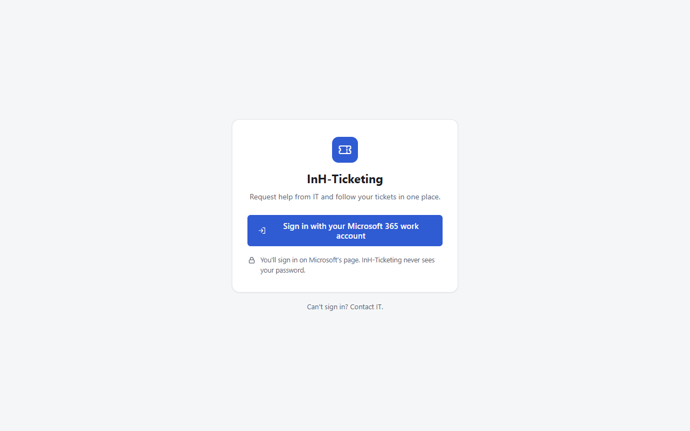
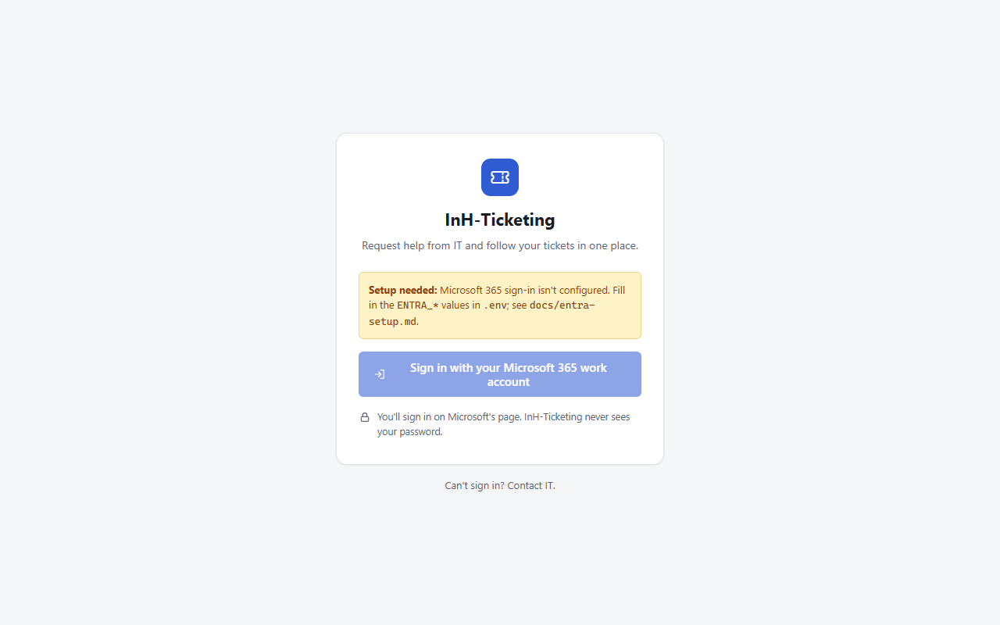
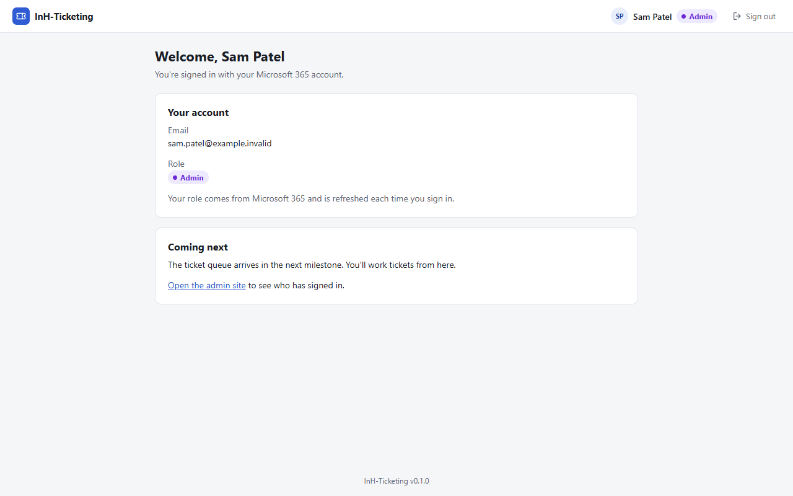
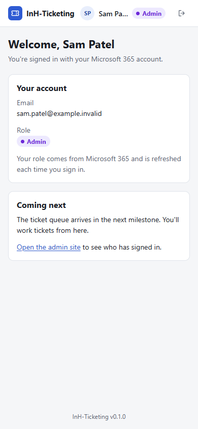

# v0.1.0: Skeleton and Microsoft 365 sign-in (milestone 1)

**Date:** 2026-11-05
**Commit:** `5a9d572` on `main`

The first build of InH-Ticketing. There are no tickets yet. It proves that
the company's staff can sign in with their Microsoft 365 work accounts, and
that their role (Requester, Agent or Admin) comes from Entra.

Screenshots were taken afterwards from a clean checkout of `5a9d572`, using a
fictional demo account, in light mode.

## Sign-in

One button and no password field. People sign in on Microsoft's own page and
the app never sees their password. Shown as it looks once Entra is configured.

Until the `ENTRA_*` settings are filled in, the page says what's missing
instead of failing.

Sign-in problems get a plain-English page. The common Entra errors (not given
access, wrong redirect address, expired secret) each have their own message.

## Home

A placeholder home page that confirms who you are and the role Microsoft 365
gave you. Admins get a link to the admin site.

| Desktop | Phone |
|---|---|
|  |  |

## What's in it

- A Django 6.1 project with every setting read from environment variables (`.env`).
- Microsoft 365 (Entra ID) sign-in through MSAL: the OpenID Connect
  authorization code flow with PKCE, with a check that the account belongs
  to the company's tenant.
- People are created on first sign-in, keyed on their permanent Entra ID.
  Their name, email and role refresh on every sign-in.
- Roles come from Entra app roles: Requester (the default), Agent and Admin.
  Admins get the Django admin site, which also signs in through Microsoft 365.
- Sign-out ends the InH-Ticketing session only, not Outlook or Teams.
- A Dockerfile and Docker Compose setup with PostgreSQL 17, and a `/healthz` endpoint.
- An Entra setup guide: [docs/entra-setup.md](../entra-setup.md).
- Tests: 40, all passing.

## Known gaps

- Real Microsoft sign-in can't be tested until the app registration exists in Entra.
- The Docker setup is untested, because this PC has no Docker yet.
