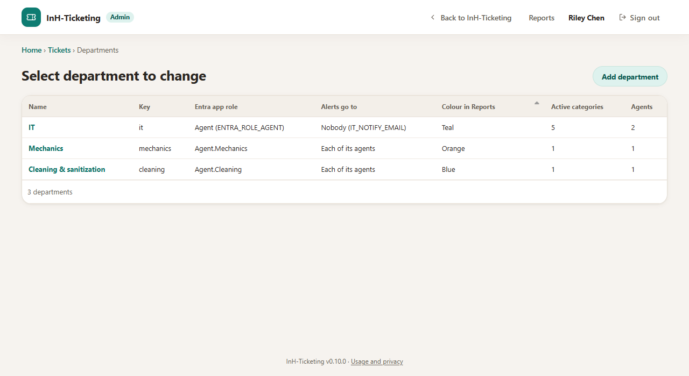
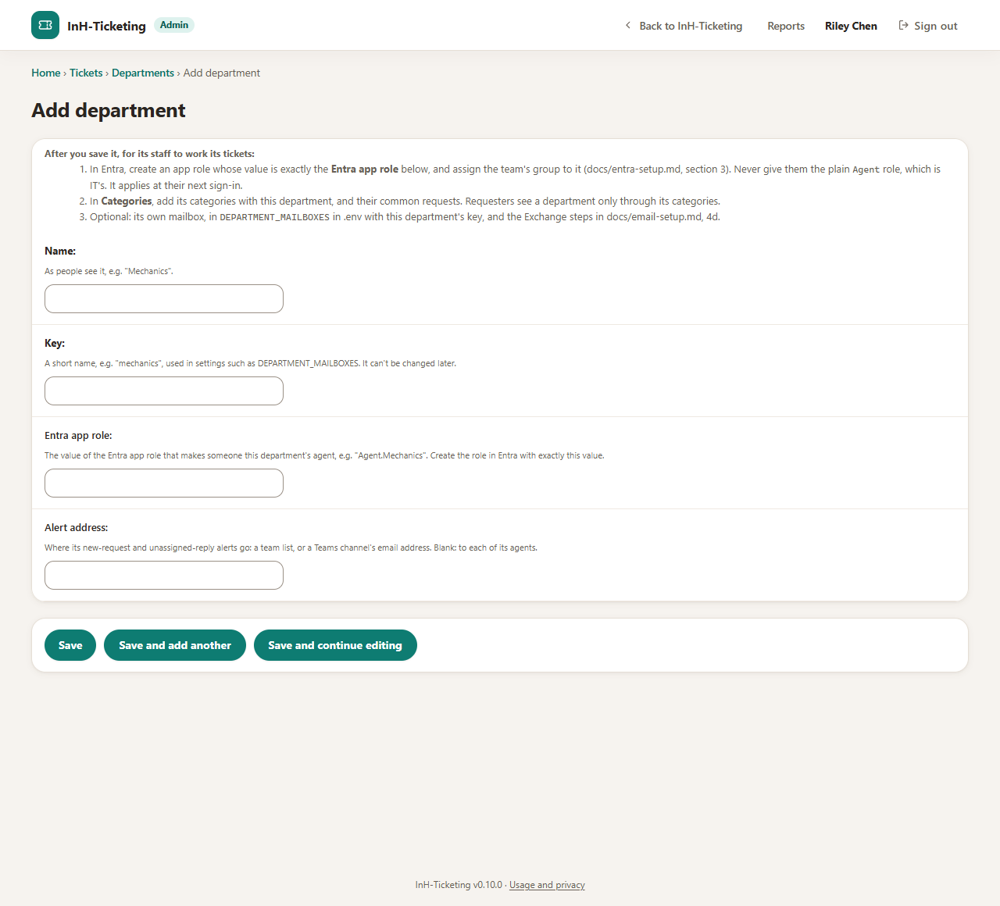

# v0.10.0: Departments set up by admins

**Date:** 2026-11-11
**Built on:** `main`

Until now the departments were fixed in the code: IT, Mechanics, and Cleaning
& sanitization. Now an admin sets them up in the admin site, so each company
that uses the app has its own teams. IT is built in, and a new install starts
with IT only.

Nothing changes for people using the app: an upgrade keeps IT, Mechanics and
Cleaning & sanitization as they are. Screenshots use fictional demo data.

**Before installing, read [Upgrading](#upgrading):** three settings move out
of `.env`.

## Departments in the admin site

Admins find them under **Tickets → Departments**. The list shows each one's
Entra app role, where its alerts go, its colour in Reports, and how many
active categories and agents it has.

### Adding one

**Add department** asks for:
- **Name:** as people see it, e.g. "Plumbing".
- **Key:** a short name, e.g. `plumbing`, used in `DEPARTMENT_MAILBOXES`. It
  can't be changed later, because tickets, notes and people store it.
- **Entra app role:** the value of the role that makes someone its agent,
  e.g. `Agent.Plumbing`.
- **Alert address:** where its new-request alerts go. Leave it blank and they
  go to each of its agents.

The page lists what to do once it's saved:
1. In Entra, create the app role with exactly that value, and assign the
   team's group to it.
2. In **Categories**, add its categories (and their common requests).
   Requesters see a department only through its categories.
3. Optionally, give it its own mailbox (`DEPARTMENT_MAILBOXES` and the
   Exchange steps in [email-setup.md](../email-setup.md), 4d).

It then works as Mechanics and Cleaning & sanitization did in v0.9.1:
- its own queue and internal notes
- its alerts
- "Wrong department?" moves to and from it
- a "Plumbing agent" tag in the header
- its own colour in Reports

### The rules

- **IT is built in.** It can't be renamed or deleted, and its settings stay
  in `.env`: the `ENTRA_ROLE_AGENT` role, `IT_NOTIFY_EMAIL` for alerts, and
  `HELPDESK_MAILBOX`.
- **A department in use can't be deleted:** one with categories, agents or
  internal notes. To stop using it:
  - untick **Active** on its categories
  - remove its role in Entra
- **Each department needs its own Entra role.** It can't be IT's (`Agent`), the
  admins' (`Admin`), or another department's.
- **The alert address** can't be one of the app's own mailboxes, and must be
  in the organisation's domains (`INBOUND_ALLOWED_DOMAINS`).
- **Up to eight departments.** Each gets the next of eight Reports colours
  as it's added, and keeps it.
- **Pages that listed the teams** now list the departments there are:
  - sign-in ("Ask IT, Mechanics, or Cleaning & sanitization for help")
  - New request
  - My tickets
  - Usage and privacy
- **The admin site's department filters** on categories, tickets and people
  show the departments by name.

## A new install has IT only

Earlier versions added the Mechanics and Cleaning & sanitization categories
to every new install. They don't now:
- **A new company** adds its own teams.
- **With IT only**, a ticket has no "Wrong department?" or "Move to another
  department" box. They appear once another department has an active category,
  and list only departments that do.
- **The demo data** (`seed_demo`) adds those two as examples, with an agent
  each, an admin, and a ticket IT has asked to move to Mechanics.

## Reports: eight team colours

The first three are unchanged: teal for IT, orange, and blue. Then come
yellow, pink, green, violet and red, in that order.

The order was chosen so that neighbouring colours stay apart for colour-blind
readers, in light and dark. Yellow and pink are lighter than 3:1 against white,
so Reports keeps three other ways to tell the teams apart:
- the legend
- the totals
- the table view

## The clickable mockup

[mockups/ui-mockup.html](../../mockups/ui-mockup.html) is now built from the
app's own pages, with the demo data (`python manage.py build_mockup`).
- **Viewing as:** a requester, an IT agent, a Mechanics agent or an admin.
- **Light or dark**, at desktop or phone width.
- **New in it:** the Departments screens.
- **Nothing is sent or saved.**

## Upgrading

Follow [deployment.md](../deployment.md), section 10, with `v0.10.0`.
Migrations `tickets` 0008 and `accounts` 0003 run when the `web` container
starts:
- **The departments:** IT, Mechanics and Cleaning & sanitization become
  departments with the same keys, so no ticket, note or person changes. They
  also keep their colours in Reports.
- **Mechanics' and Cleaning & sanitization's settings** are copied from
  `.env`: their Entra roles (`ENTRA_ROLE_AGENT_MECHANICS`,
  `ENTRA_ROLE_AGENT_CLEANING`, or the defaults `Agent.Mechanics` and
  `Agent.Cleaning`), and their alert addresses (`DEPARTMENT_NOTIFY_EMAILS`).

**Before installing:** check that the server's `.env` sets `HELPDESK_HOSTNAME`
(the name the proxy serves, e.g. `helpdesk.example.com`). It used to default
to the first company's name; now the app won't start without it, and
`docker compose` stops with "Set HELPDESK_HOSTNAME in .env". The `.env` in
deployment.md section 5 has always set it.

**After installing:**

1. In the admin site, open **Tickets → Departments** and check the three
   rows: roles and alert addresses.
2. Remove `ENTRA_ROLE_AGENT_MECHANICS`, `ENTRA_ROLE_AGENT_CLEANING` and
   `DEPARTMENT_NOTIFY_EMAILS` from `.env`. They're no longer read, and the
   start-up log warns (`core.W001`) until they're gone.
3. `DEPARTMENT_MAILBOXES` stays as it is.

Rolling back: see deployment.md section 10, "From v0.10.0 back to v0.9.1".

## Tests

385 automated tests, all passing. The new ones cover:
- **the upgrade:**
  - a new install gets IT only
  - departments in use keep their keys and colours
  - the old settings are copied
  - internal notes count as in use
- **the checks:**
  - colours are given in order and reused
  - no more than eight
  - Entra roles
  - keys
  - alert addresses
- **a department an admin adds:**
  - its Entra role makes agents
  - they work only its tickets
  - admins filter by it and move tickets to it
  - pages name it
  - Reports gives it its own colour
  - no move boxes when there's nowhere to move to
- **the admin screen:**
  - adding one
  - IT can't be changed or deleted
  - one in use can't be deleted
  - the key is fixed
- **the rest:**
  - the warning for the old settings
  - the clickable mockup

A database made by v0.9.1, with demo data, was also upgraded with this
version, and its departments, roles and copied alert address checked.

## Not in this version

- **IT's settings in the admin site, or renaming IT.** IT stays as it is, in
  `.env`.
- **Choosing the order** of departments. They're listed in the order they
  were added, IT first.
- **More than eight departments.**
- **Department mailboxes in the admin site.** `DEPARTMENT_MAILBOXES` stays in
  `.env`, because which mailboxes the app may read is a server and Exchange
  decision.
