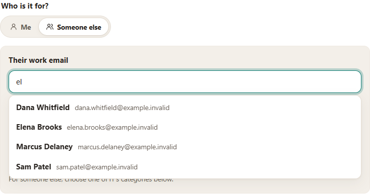
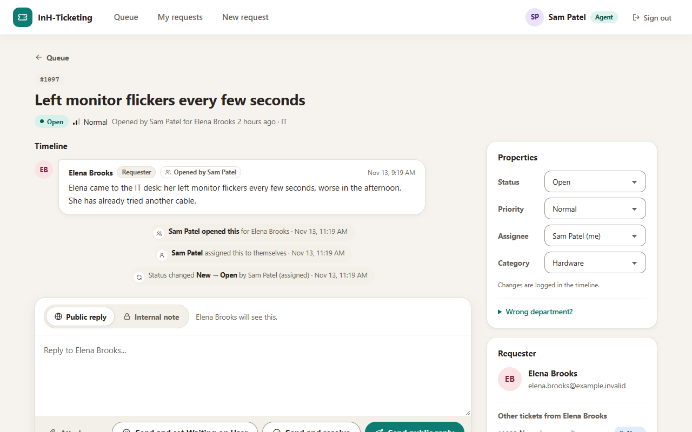
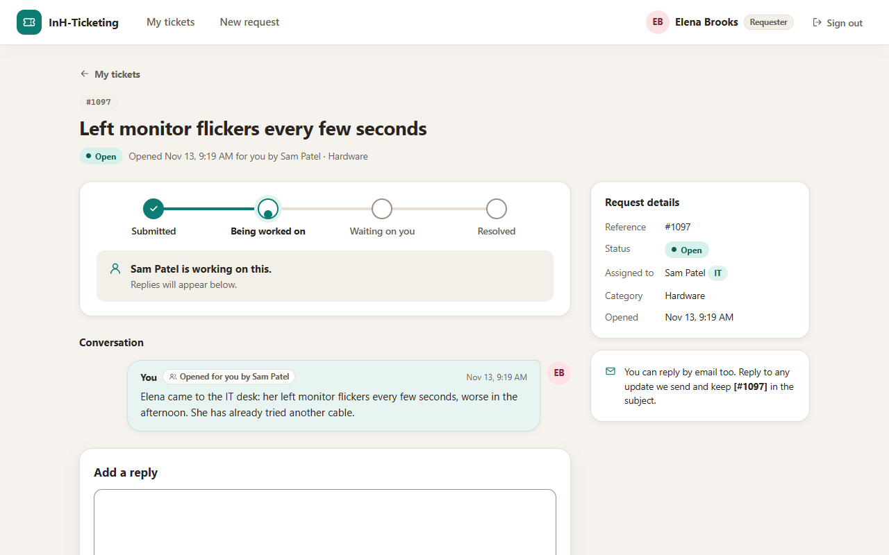
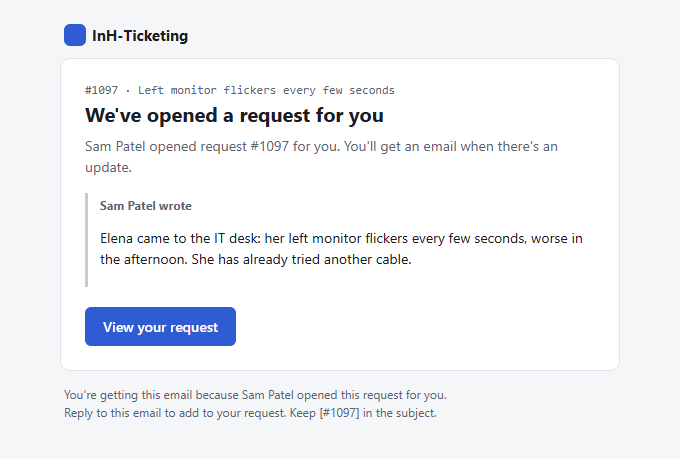

# v0.10.6: A request for someone else

**Date:** 2026-11-13
**Built on:** `main`

Someone comes to the desk, or calls over, and asks for help. Staff can now
open the request for them, so it's theirs from the start: they get the
emails, it's under their own requests, and the history says who opened it.

## "Who is it for?" on New request

Staff (agents and admins) get a new first question on New request: **Me**
or **Someone else**. Requesters don't see it, and the server ignores it
from them.

- **Find them by name or email.** Type two or more letters and up to eight
  people the help desk already knows are listed: everyone who has signed in,
  or emailed the help desk. Arrow keys and Enter, or a click, choose one.
  Only active people are listed, with their name and work email.
- **Someone it doesn't know yet** (never signed in, never emailed): type
  their full work email and their name. The app adds them the same way
  email-in already does, and their first Microsoft 365 sign-in takes the
  account over, with their tickets. Only the organisation's addresses are
  accepted (the domains in `INBOUND_ALLOWED_DOMAINS`, by default the
  help-desk mailbox's), so a typo can't send the receipt outside.
- **Their own department only.** An agent opens requests for someone else in
  their own department's categories. An admin can open any team's. For
  themselves, staff can still use any team's categories, as before.
- **Not for a turned-off account.** If the person's account is inactive, the
  form says so: an admin turns it back on under Users.
- **A follow-up stays theirs.** "Start a follow-up" on someone else's closed
  ticket fills in that person.
- **The same checks as any request:** the password check and its audit trail
  (recorded against the staff member who typed it), the 20,000-character
  limit and the attachment limits.

## On the ticket

Staff see who opened it, and for whom, at the top, on the request itself
and in the history. The side panel's **Source** says *Opened by staff*.

The person it's for sees it like any of their own requests, with *Opened
for you by Sam Patel* on it.

## The emails

The person gets a receipt saying who opened it, with what was written. The
department's new-request alert says *New request for* the person, and who
opened it.

## Usage and privacy

The page now says that staff can open a request for someone, that it's
theirs like any other, and that for someone who hasn't signed in yet, staff
type their name and work email until their first sign-in replaces them.

## Upgrading

Follow [deployment.md](../deployment.md), section 10, with `v0.10.6`. One
migration (`tickets.0010`: who opened a ticket, and the new history line);
it runs when the app starts. Nothing to do in `.env` or Entra: no new
Microsoft permissions. Rolling back to v0.10.5 needs the migration undone
first: `docker compose exec web python manage.py migrate tickets 0009`, then
check out v0.10.5 and rebuild. The tickets opened for someone stay theirs.

## Tests

472 automated tests, all passing (with this PC's `.env` email settings
neutralised; see below). The 19 new ones cover:

- requesters not getting the choice, and the server ignoring it from them;
- a request for someone the app knows (their email in any case), and for
  someone new, whose first sign-in links the account;
- a name needed for someone new, only work addresses, an email needed, a
  turned-off account, and their own email meaning it's for themselves;
- staff limited to their own department's categories, and admins not;
- a follow-up filling in the same person, and the service refusing the same
  things the form does;
- the receipt and the alert, the history line, both ticket pages, and My
  tickets;
- the people search: staff only, every word typed, never fewer than two
  letters, at most eight, no turned-off accounts, not cached.

Checked in the browser on the development server: the search, choosing with
the keyboard, sending the request, and the ticket page. Not tried on the
server.

Six older tests fail on this PC unless `INBOUND_EMAIL`, `IT_NOTIFY_EMAIL` and
`INBOUND_ALLOWED_DOMAINS` are cleared for the run, because they read this
PC's `.env`. They fail the same way without this change.
