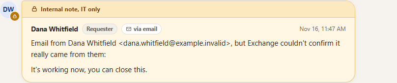
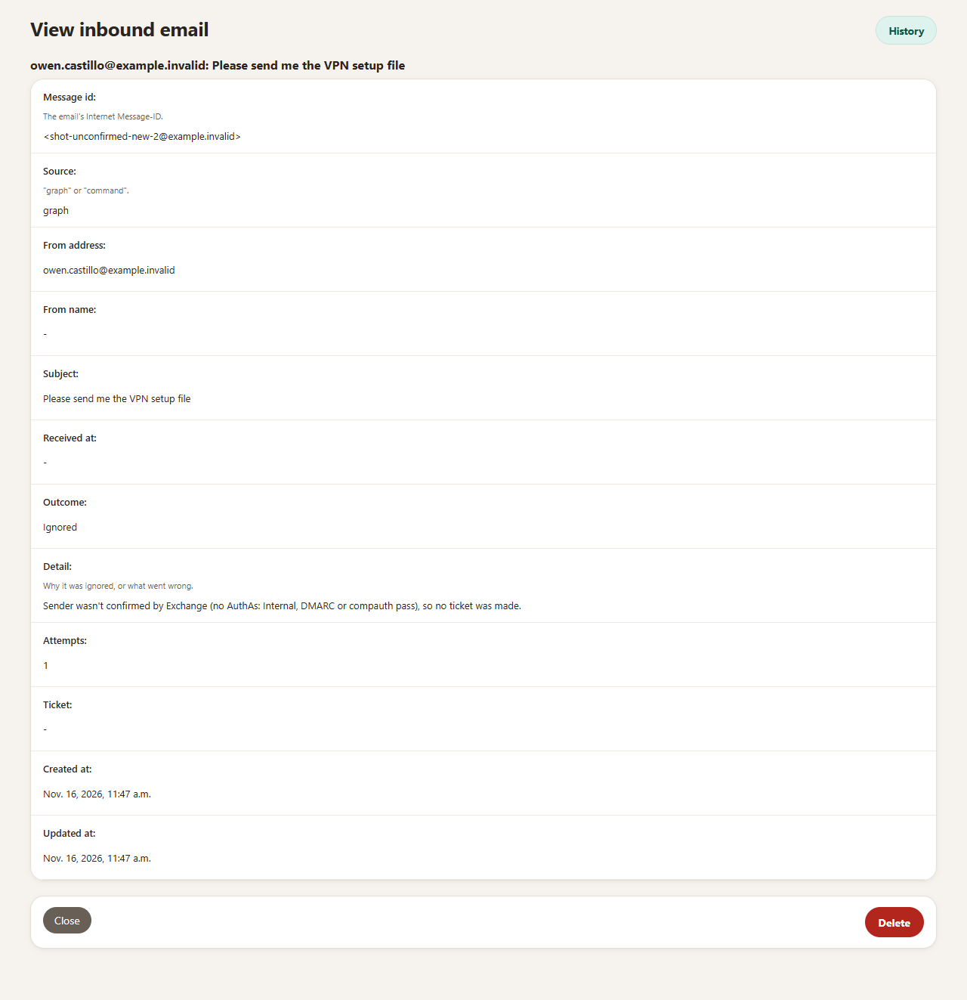
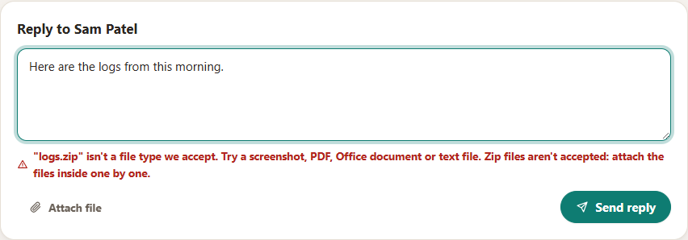

# v0.10.7: Security fixes from the audit

**Date:** 2026-11-16
**Built on:** `main`

On 2026-11-16 the app was tested against ten common weaknesses of web apps:

1. reaching other people's records;
2. leaked secrets;
3. debug settings left on;
4. injection;
5. unsafe uploads;
6. weak sign-in;
7. CSRF, CORS and cookies;
8. dependency problems;
9. email-in abuse;
10. a missing audit trail.

The test ran against a throwaway database, with 41 attacks, a read of the
code and a check of every page in Edge.

**What held:**
- No ticket, reply, note or file of someone else's could be reached, by
  changing a number in the address or otherwise.
- Staff and admin pages are checked on the server.
- Text is never run as code, and secrets never reach a page.
- Every form needs its CSRF token.
- No package the app uses has a known security issue.

**What this version fixes:** the gaps below. The attacks are now part of the
test suite (`tickets/tests/test_security_audit.py`), so every later change
is checked against them.

## No debug mode on the server

Debug mode shows the program's inner workings on error pages, and switches
off the HTTPS protections (secure cookies, the redirect, HSTS). `.env.example`
has `DJANGO_DEBUG=True` for PCs, so a server `.env` copied from it would have
been unsafe, and the app only printed warnings.

Now the app refuses to start when `DJANGO_DEBUG` is on and
`DJANGO_ALLOWED_HOSTS` names a real host (anything but localhost, 127.0.0.1,
::1 or `*.localhost`):

```
DJANGO_DEBUG is on, but DJANGO_ALLOWED_HOSTS has helpdesk.example.com. Debug mode is for
a PC only (localhost): set DJANGO_DEBUG=False in .env on the server, then start the app again.
```

The server's `.env` already had `DJANGO_DEBUG=False` (checked 2026-11-16), so
this is a safety net for the next install.

## Unconfirmed email "from the requester"

Since v0.9.1, an email that claims to be from IT only becomes a public reply
if Exchange confirmed who sent it. An email claiming to be from the
**requester** wasn't checked. Anyone who could get an email into the mailbox
with the requester's address in the From line could add a reply in their
name, or reopen their ticket. The mailbox's internal-senders-only setting
already blocks that from outside the company; this is the second line of
defence.

Now every sender is checked the same way:

- **A reply Exchange can't confirm** is kept as an internal note, marked as
  unconfirmed. The requester never sees it, and it doesn't reopen or answer
  the ticket. Staff decide what to do with it.

  

- **A new request Exchange can't confirm** is ignored: no ticket, no account
  in that person's name, no receipt. It's listed in the admin site under
  Inbound emails, with the reason.

  

Genuine email from colleagues is always confirmed: Exchange marks email sent
inside the organisation as such. `INBOUND_VERIFY_IT_SENDERS=false` still turns
the check off, for an Exchange that doesn't add those headers.

## A Content-Security-Policy

Every page now tells the browser to run only the app's own script and
styles. Text from a ticket is already shown as text, never run; this is the
backstop if that were ever to fail.

To make room for it:
- the queue's filter lists apply on change from `app.js`, not from inline code;
- the icon sprite is hidden by a CSS class, not an inline style;
- the 500 page, which has its own styles so it works even without static
  files, carries the per-request nonce.

The admin site already supported it. A check of every kind of page in Edge,
as each role, found nothing blocked. Nothing looks different.

To switch it off in an emergency: `SECURE_CSP = {}` in `config/settings.py`.

## No zip files

A `.zip` can hide any file type, and nothing scans inside it, so it isn't
accepted any more, on the web form or by email. The form says what to do:



- **By email:** the ticket says the zip wasn't attached, and the email itself
  stays in the mailbox's Processed folder.
- **Already on tickets:** zip files still download.
- **Why not a virus scanner:** decided 2026-11-16. Exchange already scans
  email attachments, and staff PCs' antivirus scans downloads.

## The update check covers every package

`scripts/check_updates.py` (the monthly check, deployment.md section 11) used
to look only at the seven packages in `requirements.txt`. It now also checks
the packages they need, such as cryptography, requests and PyJWT. That's 14
more, all clear on 2026-11-16.

## Not in this version

- **v0.11.0, access logging:**
  - what it records: every sign-in (success and failure) and every file
    download, kept for 2 years, read-only for admins;
  - first: the compliance lead's review, the usage and privacy page and
    `usage-rules.md`.
- **For you:** confirm in Entra that MFA is required for the app.
- **The server:** it still runs v0.6.0. Update it straight to this version
  (deployment.md section 10).
