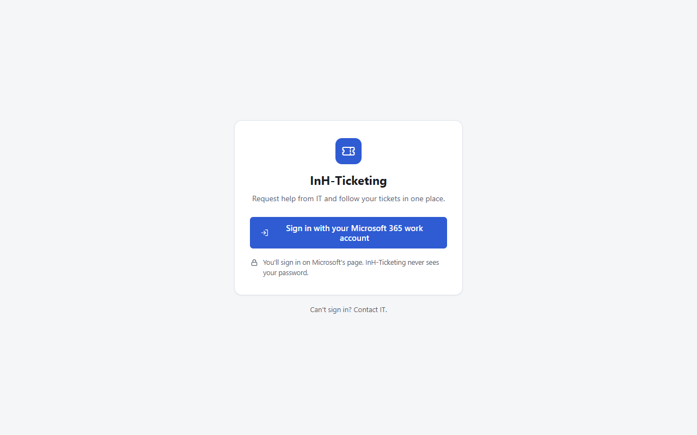
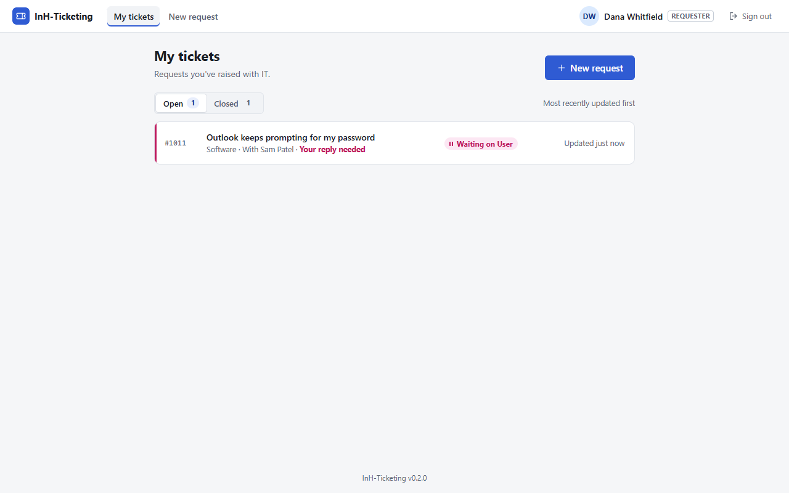
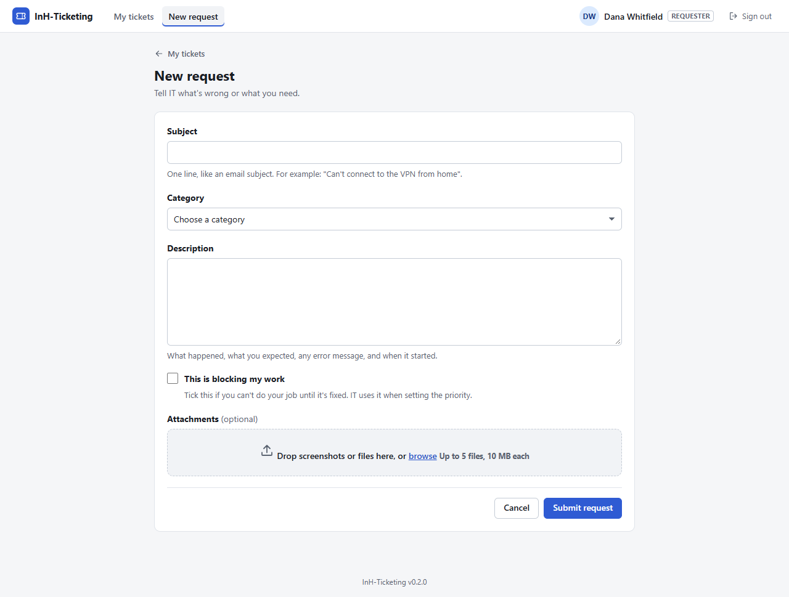
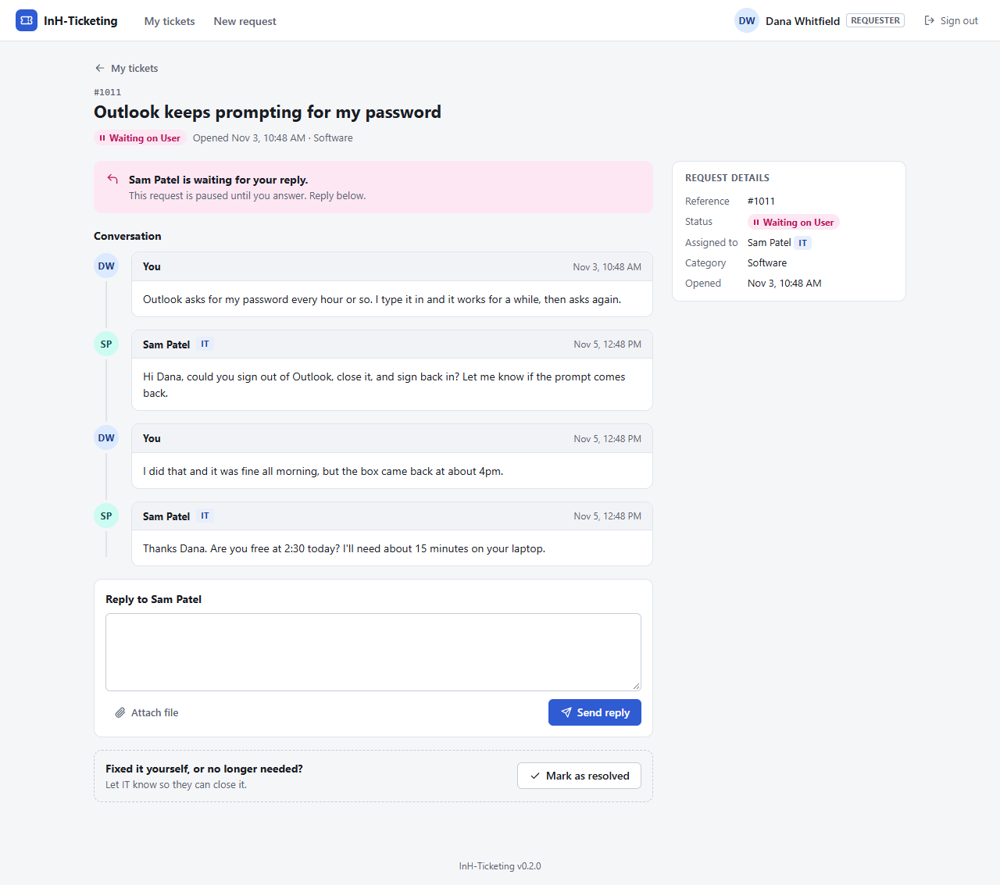
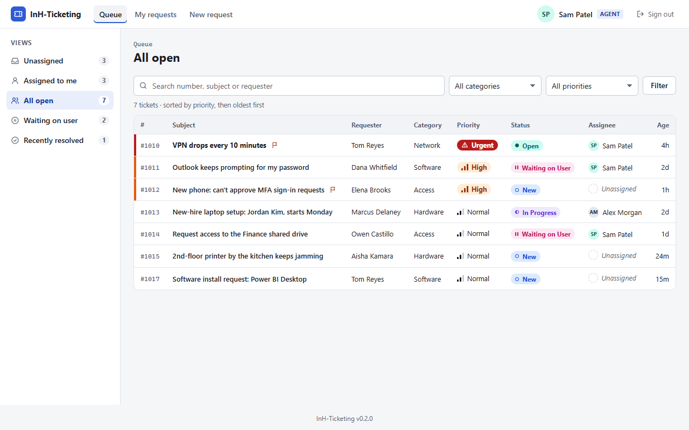
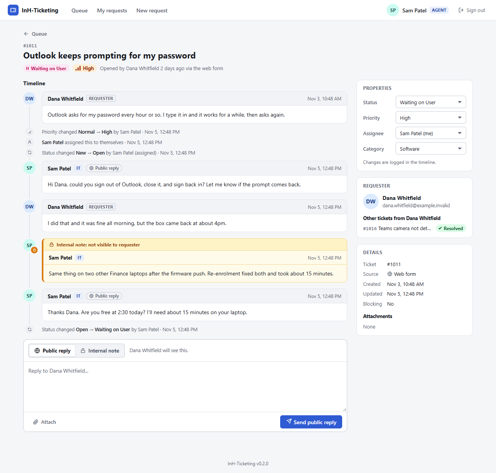
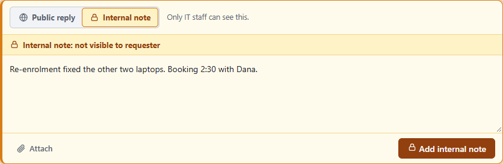
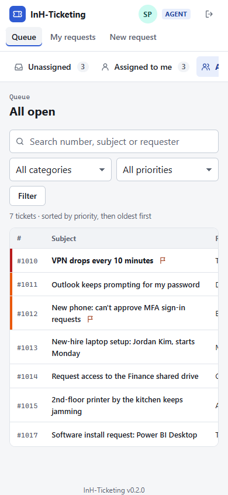
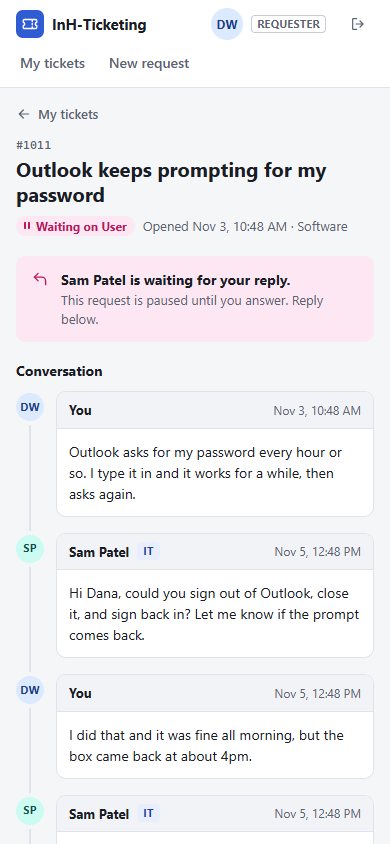

# v0.2.0: Tickets (milestone 2)

**Date:** 2026-11-05
**Branch:** `milestone-2-tickets`

InH-Ticketing now works end to end as a help desk: staff submit requests, IT
works them from a queue, and both sides talk on the ticket. IT can also leave
internal notes that requesters never see.

Screenshots use fictional demo data (`python manage.py seed_demo`) in light mode.

## For requesters

**Sign-in.** Unchanged since v0.1.0, apart from the button label now wrapping
on narrow screens. Shown as it looks once Entra is configured.

**My tickets.** Open and Closed tabs. A ticket waiting on the person has a
pink edge and a "Your reply needed" line. "Updated" counts public activity
only, so internal notes don't give anything away.

**New request.** Subject, category (with examples), description, a "This is
blocking my work" checkbox instead of a priority field, and attachments: up to
5 files, 10 MB each, from an allowlist of file types.

**Ticket page.** A status banner, the conversation (public replies only),
a reply box, and "Mark as resolved". Resolved tickets offer "This is still a
problem" instead of the reply box.

## For IT

**Queue.** Five views with counts, search by number, subject or requester,
category and priority filters, and sorting by priority and then oldest.
Urgent and High tickets get a coloured edge.

**Ticket page.** The full timeline: the request, public replies, internal
notes (amber, with a lock) and a history line for every change. The side panel
saves status, priority, assignee and category as soon as one changes.

**Internal note mode.** Switching the composer to *Internal note* turns it
amber, adds the "not visible to requester" banner, and changes the button to
"Add internal note", so it's obvious at the moment of sending.

## On a phone

| IT queue | Requester ticket |
|---|---|
|  |  |

## Ticket rules

| When | Status becomes |
|---|---|
| Someone submits a request | New |
| IT replies publicly, or assigns the ticket | New → Open |
| The requester replies to a Waiting on User or Resolved ticket | → Open |
| The requester clicks "Mark as resolved" | → Resolved |
| The requester clicks "This is still a problem" | Resolved → Open |

## Privacy and safety

- Requesters are only ever sent public replies. Internal notes, files attached
  to them, and the history log are filtered out on the server. Tests check the
  raw HTML for leaks.
- Someone else's ticket or attachment returns "not found", so its existence isn't revealed.
- Attachments are saved under random names, always download rather than open
  in the browser, and are checked against a file-type allowlist and a size limit.
- Ticket changes save only the fields that changed, so two IT staff editing the
  same ticket don't overwrite each other.

## Under the hood

- New `tickets` app: `Category`, `Ticket`, `Comment` (public or internal),
  `TicketEvent` (history) and `Attachment`.
- Ticket numbers start at #1001 and are separate from database IDs.
- All ticket rules live in `tickets/services.py`; who-sees-what lives in `tickets/selectors.py`.
- `/` sends IT to the queue and everyone else to their tickets.
- Docker Compose stores uploads in a `media` volume. Back it up with the database.
- New dev tools: `seed_demo` (demo data) and `release_screenshots` (these images).
- Tests: 88, all passing (up from 40).

## Not in this version

Email (milestones 3–4), auto-closing resolved tickets and linked tickets
(milestone 5), and deployment to the server (milestone 6).
