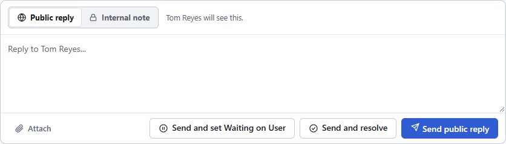
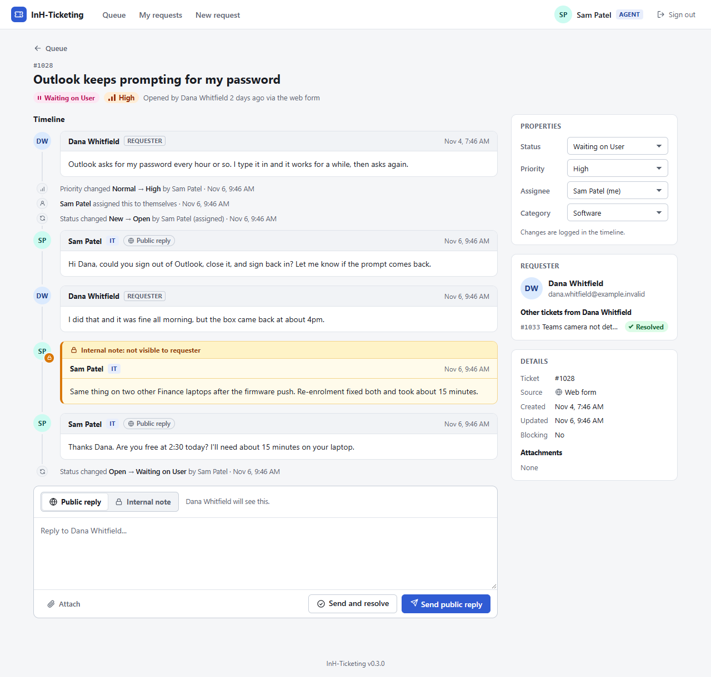
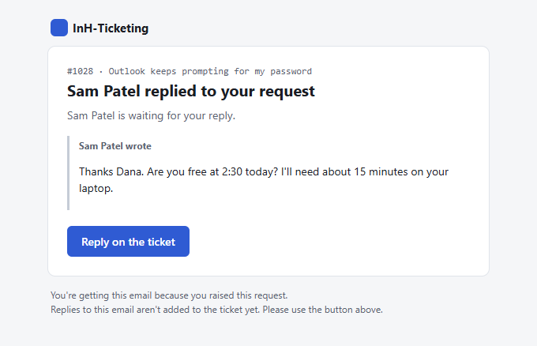
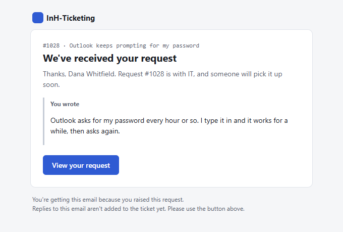

# v0.3.0: Outbound email (milestone 3)

**Date:** 2026-11-06
**Branch:** `milestone-3-email`

People now get an email when something happens on their ticket, and IT can
reply and change the status in one click. Emails are queued in the database
and sent by a background worker, so a slow or broken mail system never stops
anyone saving a ticket.

Screenshots use fictional demo data in light mode. Only the screens that
changed are shown; see [v0.2.0](v0.2.0.md) for the rest.

## Reply and set the status in one click

From testing: IT could only resolve a ticket from the Status dropdown, which
was easy to miss. The composer now has **Send and set Waiting on User** and
**Send and resolve** next to the reply button. They only appear for public
replies, and a button is hidden when the ticket already has that status. The
requester gets a single email that covers both the reply and the status change.

An IT ticket page, with the timeline, an internal note and the composer.

## Emails

Every email about a ticket has the same subject, `[#1028] Outlook keeps
prompting for my password`, so mail apps group them into one conversation.
Each has a button back to the ticket and says why the person received it.
Replying by email isn't supported yet (milestone 4), and each email says so.

| IT replied (with "Send and set Waiting on User") | Request received |
|---|---|
|  |  |

### Who gets what

| Event | Email goes to |
|---|---|
| A request is submitted | The requester (receipt), plus `IT_NOTIFY_EMAIL` if set |
| IT posts a public reply | The requester |
| The requester replies or reopens | The assignee, or `IT_NOTIFY_EMAIL` if unassigned |
| A ticket is assigned | The new assignee (not on self-assignment) |
| IT resolves a ticket | The requester |

Internal notes never send an email and never appear in one. Nobody is emailed
about their own action. Inactive accounts and accounts without an address are skipped.

## How sending works

- **Queue:** each email is stored as a row (`OutboundEmail`) in the same
  transaction as the ticket change, so an email is only queued if the change saved.
- **Worker:** `python manage.py run_worker` sends queued emails every 15 seconds.
  A failure is retried after 1, 5, 15 and 60 minutes, and marked *Failed*
  after 5 attempts. In Docker it's the new `worker` container.
- **Where emails go:**
  - `EMAIL_BACKEND=file` (the default) writes them to `tmp/emails/`, and nothing is sent.
  - `console` prints them in the worker's terminal.
  - `graph` sends through Microsoft 365 from `HELPDESK_MAILBOX`.
- **Admin site:** a new *Outbound emails* list shows every email, its status
  and any error, with a *Retry selected emails now* action.

## Microsoft 365 sending

Graph sending reuses the sign-in app registration. It's limited to **one
shared mailbox** with Exchange Online RBAC for Applications, *not* with an
Entra API permission, because that would cover every mailbox in the company.
The step-by-step setup is in [docs/email-setup.md](../email-setup.md).

**Not yet tried against the real tenant.** The code is tested with Microsoft's
responses faked; real sending needs the Exchange setup first.

## Also in this version

- [docs/backlog.md](../backlog.md), the running to-do list.
- New `.env` settings: `EMAIL_BACKEND`, `SITE_URL`, `HELPDESK_MAILBOX`, `IT_NOTIFY_EMAIL`.
- The demo data uses the new "Send and ..." buttons.
- `release_screenshots --only` captures just the screens that changed.
- Tests: 113, all passing (up from 88).

## Not in this version

Reading the inbox (milestone 4), auto-close and linked tickets (milestone 5),
and the server with HTTPS (milestone 6).
