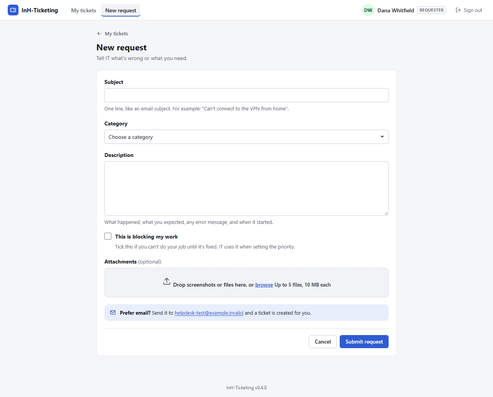
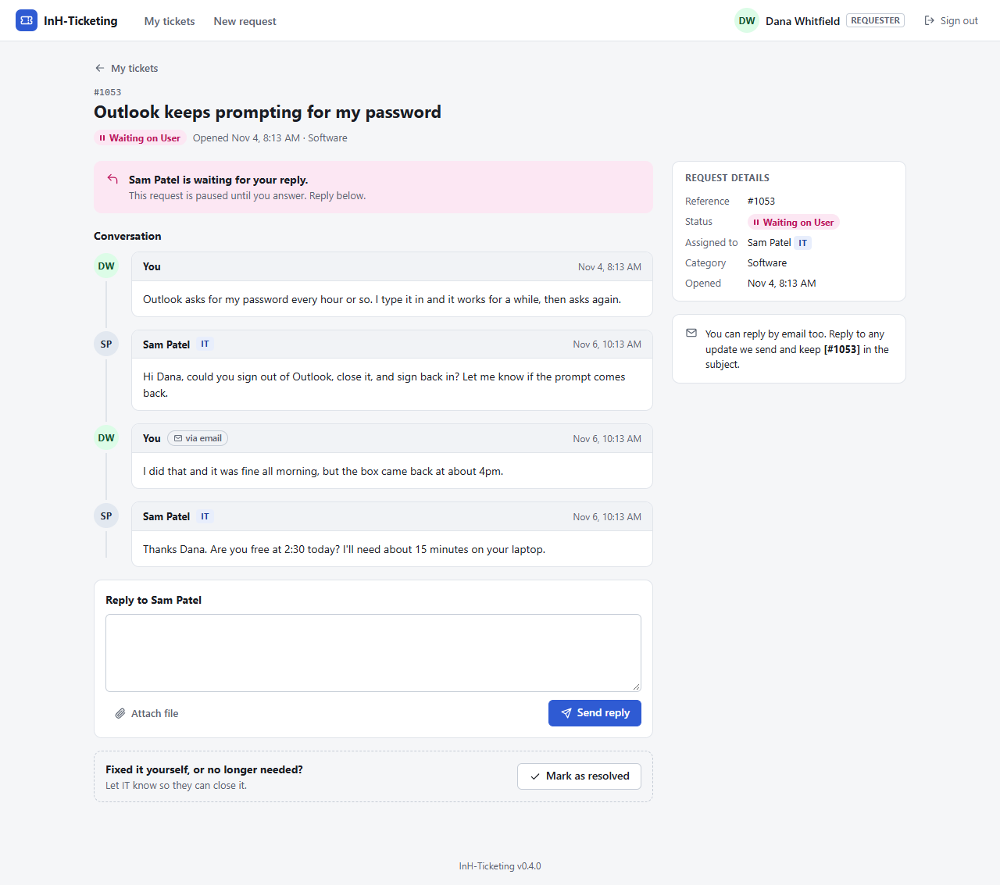
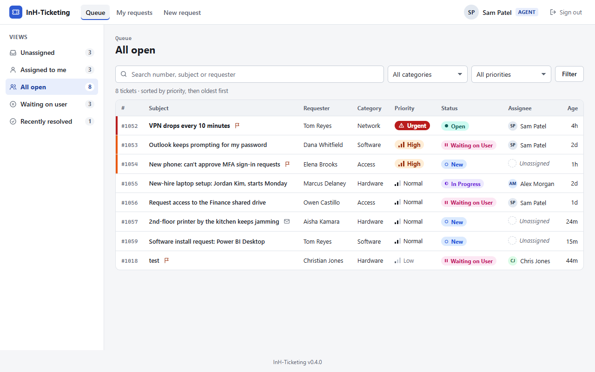
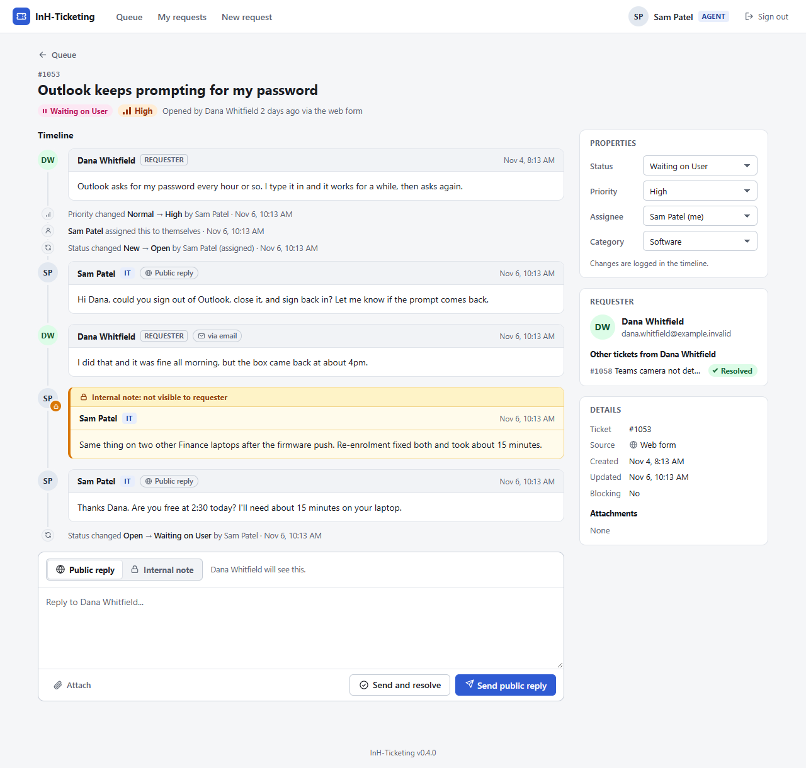
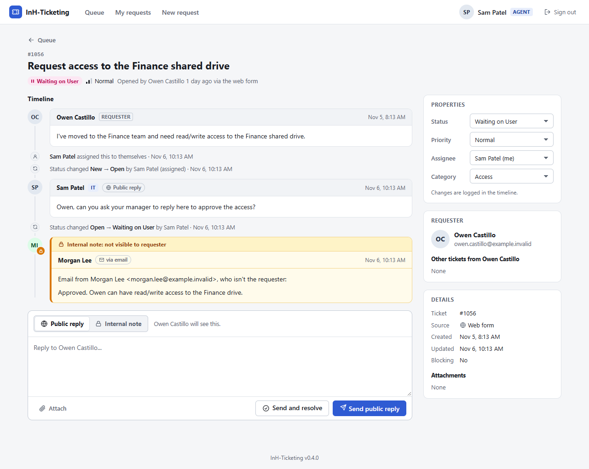
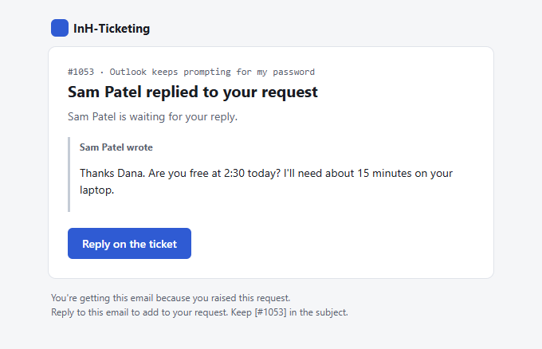
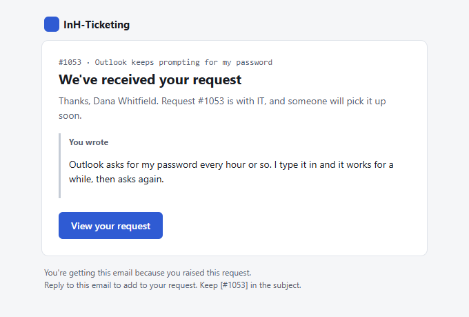

# v0.4.0: Email in (milestone 4)

**Date:** 2026-11-06
**Branch:** `milestone-4-inbound`

Email the help desk, and it becomes a ticket. Reply to one of our emails,
and the reply lands on the right ticket. The background worker reads the test
shared mailbox through Microsoft Graph every minute, and every email follows
one set of rules.

Screenshots use fictional demo data in light mode, with email-in switched on
(`INBOUND_EMAIL=graph`) and a placeholder mailbox. Only the screens that
changed are shown; see [v0.3.0](v0.3.0.md) and [v0.2.0](v0.2.0.md) for the rest.

## What happens to an email

| The email | What the app does |
|---|---|
| Out-of-office reply, bounce, mailing list | Ignored, so mail can't loop |
| From outside your domain, or from the help-desk mailbox itself | Ignored, and **nothing is sent back** |
| Subject has `[#1053]`, from the requester or IT | A public reply on #1053, keeping only the new text |
| Subject has `[#1053]`, from anyone else | An **internal note** for IT, and the assignee is alerted |
| Subject has `[#1053]`, but #1053 is closed | A new follow-up ticket that links to #1053 |
| Anything else | A new ticket, and the sender gets a receipt |

Every email is recorded in the admin site (**Inbound emails**) with what
happened and why, and the same email is never processed twice.

## For requesters

Requesters are told they can email instead. The hints appear only when
email-in is switched on.



On a ticket, an emailed reply is marked *via email*, and the side panel
explains how to reply by email.



## For IT

Tickets that arrived by email carry a mail icon in the queue (#1057 here).





**Someone other than the requester** (here, Owen's manager approving access)
is saved as an **internal note**, so IT decides what the requester sees.



## Email footers now say what replying does

Requesters are told to keep `[#1053]` in the subject. IT emails warn that
replying **posts a public reply the requester will see**. With email-in off,
the footer still says replies aren't read.

| IT replied | Request received |
|---|---|
|  |  |

## Safety

- **No mail loops.** Automatic emails are recognised by their headers
  (`Auto-Submitted`, `Precedence`, list headers) and, as a fallback, by subject.
  Outgoing emails also ask Exchange to suppress automatic replies.
- **No replies to strangers.** Only accepted domains are processed (by default
  the mailbox's own domain). Others are ignored silently, so forged senders
  never get mail.
- **Text only.** Microsoft is asked for plain text; outside HTML is never stored or shown.
- **Attachments follow the web rules,** and anything left out is listed in the message.
- **One bad email can't jam the inbox.** It's retried 3 times, then marked read
  and left for a person.
- **Forged sender addresses** are Exchange's job (SPF, DKIM and DMARC). That's on
  the backlog to confirm before email-in is relied on.

## Trying it

On a PC, without Microsoft 365:

```powershell
.\.venv\Scripts\python.exe manage.py ingest_email --from dana.whitfield@example.invalid --subject "Laptop fan is loud" --body "Sounds like a jet"
```

Connecting the real test mailbox needs one more Exchange permission
(*Application Mail.ReadWrite*, on the same one-mailbox scope as sending). See
[docs/email-setup.md, section 4](../email-setup.md).

**Not yet tried against the real mailbox.** Graph is faked in the tests. The
same rules were also tried end to end on the PC with `ingest_email`, which
caught one real gap: out-of-office emails without the usual headers. They're
now recognised by subject as well.

## Also in this version

- Colleagues who email before ever signing in get an account, linked to their
  Microsoft 365 account on first sign-in.
- Sending and reading share one Graph client.
- The demo data has an email-sourced ticket, an emailed reply, and a manager's emailed approval.
- Tests: 151, all passing (up from 113).

## Not in this version

Auto-closing resolved tickets and the web version of "reply to a closed
ticket" (milestone 5), and the server with HTTPS (milestone 6).
