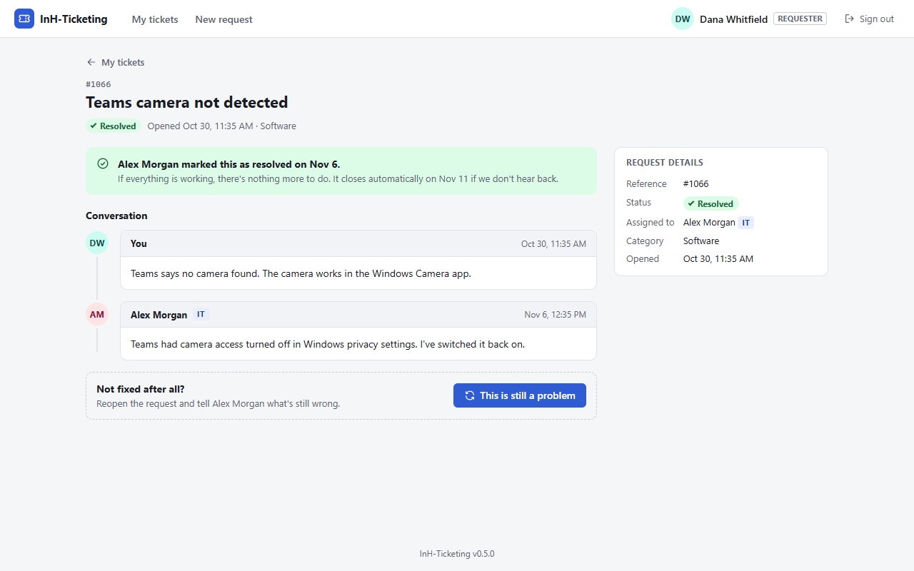
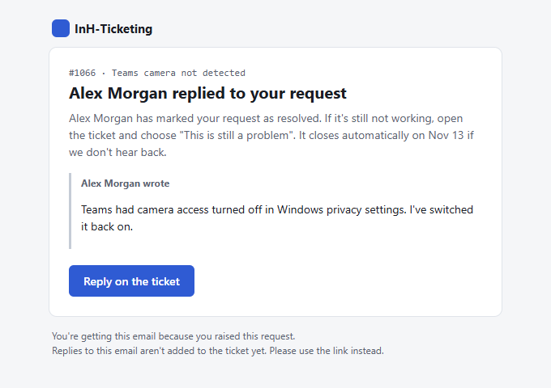
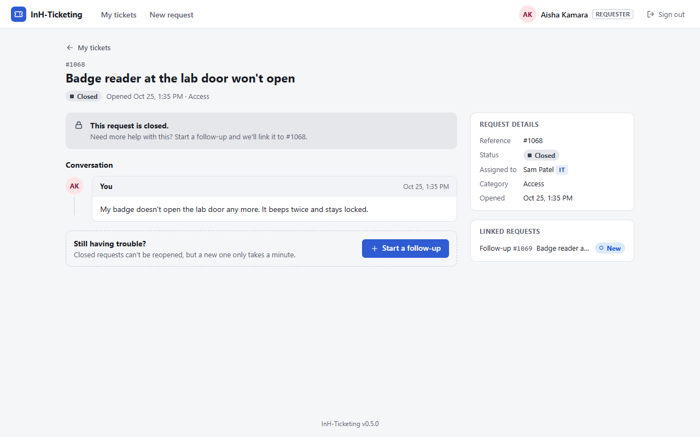
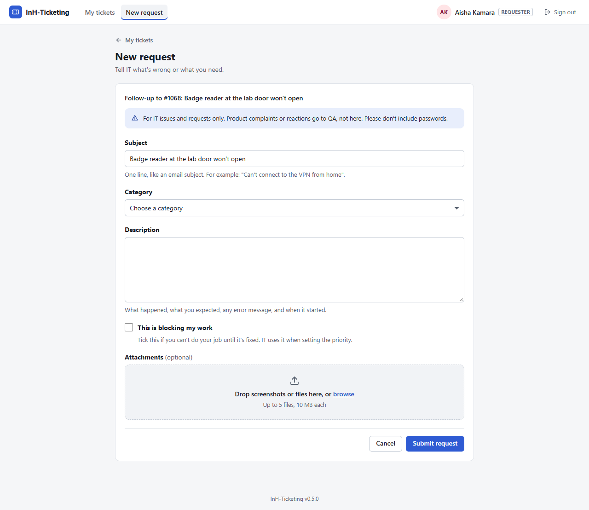
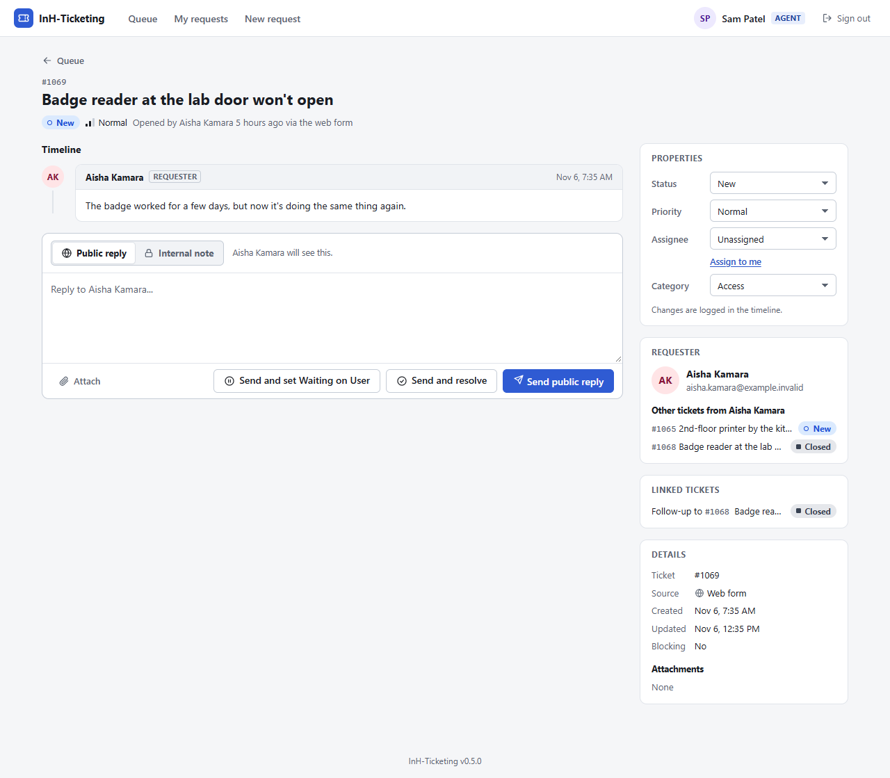
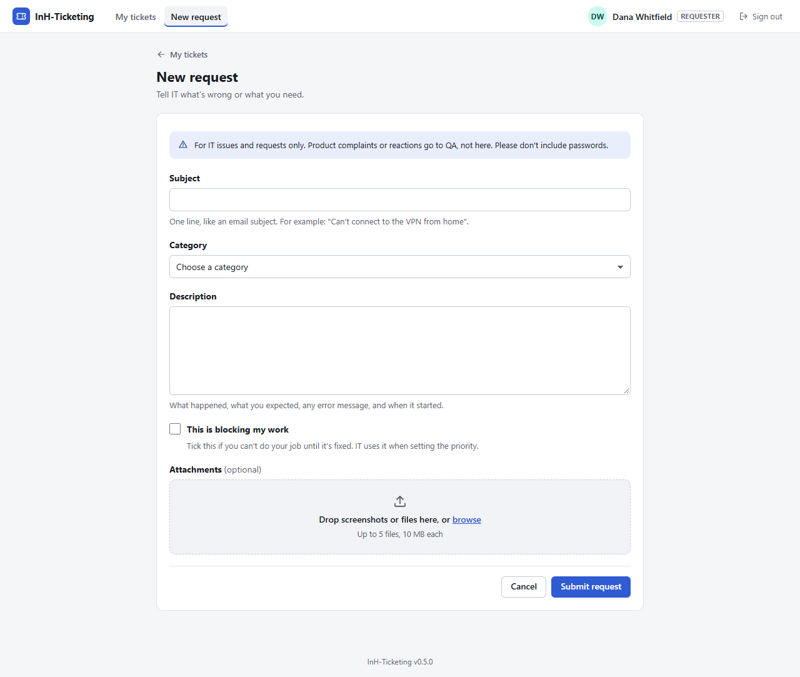

# v0.5.0: Automations, follow-ups, and FDA usage controls (milestone 5)

**Date:** 2026-11-06
**Branch:** `release-v0.5.0` (built with `milestone-5-automations`)

Resolved tickets now close on their own, closed tickets can be followed up
with a linked new request, and the controls from the FDA risk assessment are
in place in the app and the docs. The compliance lead reviewed the assessment, and
management approved setting the system up internally.

Screenshots use fictional demo data in light mode, with the default
settings (email-in off). Only the screens that changed are shown.

## Resolved tickets close themselves

A Resolved ticket closes automatically **7 days** after it was resolved, if
the requester doesn't reply (`AUTO_CLOSE_RESOLVED_DAYS`; 0 turns it off).
Requesters are told the date on the ticket page and in the email, and the
history records it as an automatic change. A reply before then reopens the
ticket as before. The background worker runs this once an hour;
`manage.py close_resolved` runs it on demand.

*In the demo the email and the page show different dates: the demo data
backdates the resolution after the email was sent. In real use they match.*

## Follow-ups and linked tickets

A Closed ticket offers **Start a follow-up**, which opens a new request
already linked to it, with the subject filled in. Both tickets then show the
link: under **Linked requests** for the requester and **Linked tickets** for IT.
Email replies to a closed ticket now create the same link. Requesters only
ever see links to their own tickets.

| Closed ticket | The follow-up form |
|---|---|
|  |  |

## FDA usage controls

From the intended-use and risk assessment reviewed with the compliance lead:

- **On-screen notice** at the top of every new request: *"For IT issues and
  requests only. Product complaints or reactions go to QA, not here. Please
  don't include passwords."*
- **[Usage rules](../usage-rules.md):** what the help desk is and isn't for,
  where non-IT items go, and what IT does when one arrives (complaints go to
  QA the same day and are never deleted). Future uses, such as maintenance,
  and cleaning and sanitization, need a review before they start.
- **Internal senders only:** a step in [email-setup.md](../email-setup.md) (3a)
  makes the help-desk mailbox refuse outside email. It still has to be applied in Exchange.

## Fixed

- The attachment drop area on the New request page lost its stacked layout
  in v0.2.0 (a general label style overrode it). It's back to the mockup's design.

## Also in this version

- [docs/roadmap.md](../roadmap.md): versions, target dates and alternative paths.
- The demo data includes a closed ticket with a follow-up, and a resolved ticket waiting to auto-close.
- Tests: 170, all passing (up from 151).

## Not in this version

- **Waiting on User reminders:** still optional, on the backlog.
- **The deployment package (v0.6.0):** in progress on its own branch, and
  released only after it's been tested on the real server.
