# v0.7.0: The new look, the password check, and folded email signatures

**Date:** 2026-11-09
**Built on:** `main`

The release for the pilot, which starts on 2026-11-10. Everything looks new,
staff are warned before they send a password, every warning is kept in an
audit trail, and email signatures no longer fill up tickets. The target is
to have everything finalized by Friday 2026-11-20 ([roadmap](../roadmap.md)).

Screenshots use fictional demo data in light mode, with the default settings
(email-in off). Every screen changed, so all of them are shown.

## The new look

Chosen from three design renditions: **"Friendly Soft"**. Warm neutrals with
one teal accent, rounded cards and soft shadows, and larger buttons that are
easier to hit on a phone. It stays simple: gentle motion where it helps (cards
easing in, the reply box changing to an internal note), and none at all for
people who turn on "reduce motion". Dark mode follows the computer's setting.

Every colour, font, corner radius and timing lives in one place at the top of
`static/css/app.css`, so a company's own brand can be dropped in later.

| Sign-in | My tickets |
|---|---|
| 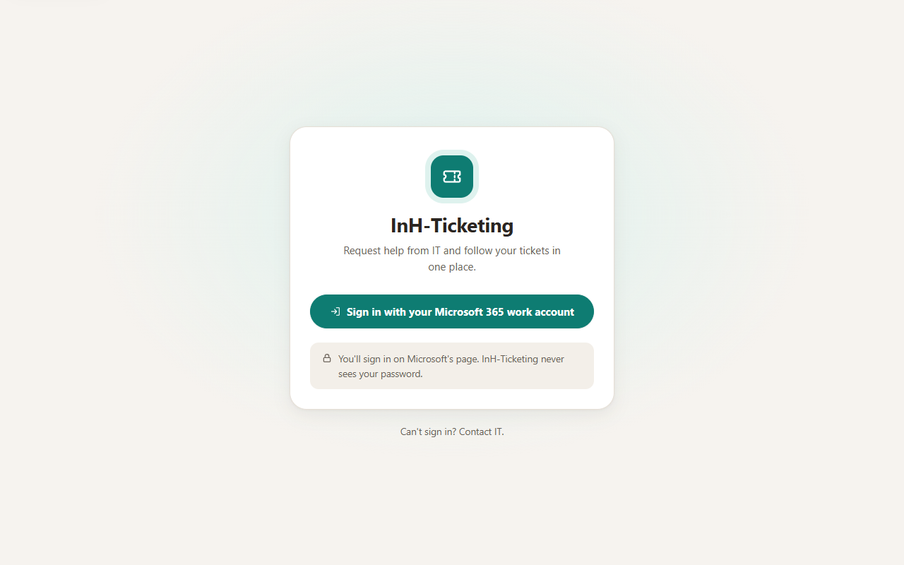 | 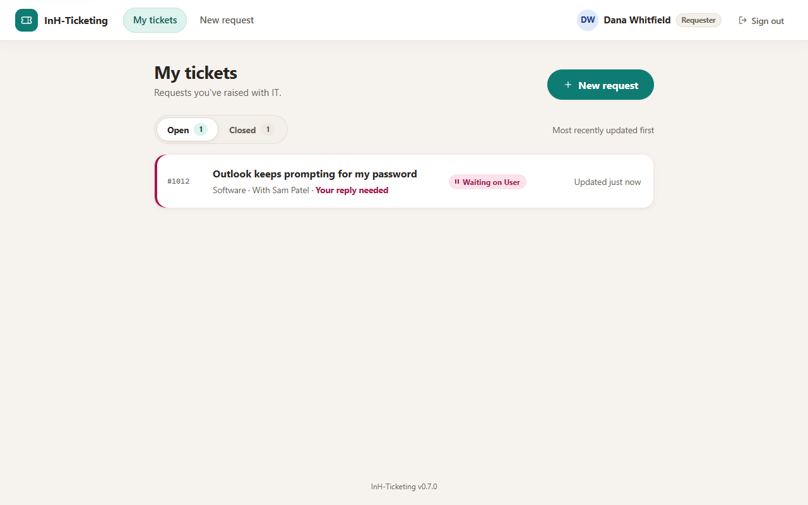 |

### For staff: a progress tracker and a chat-style conversation

The ticket page shows where a request is (**Submitted, With IT, Waiting on
you, Resolved**), and the conversation reads like a chat, with your own
messages on the right.

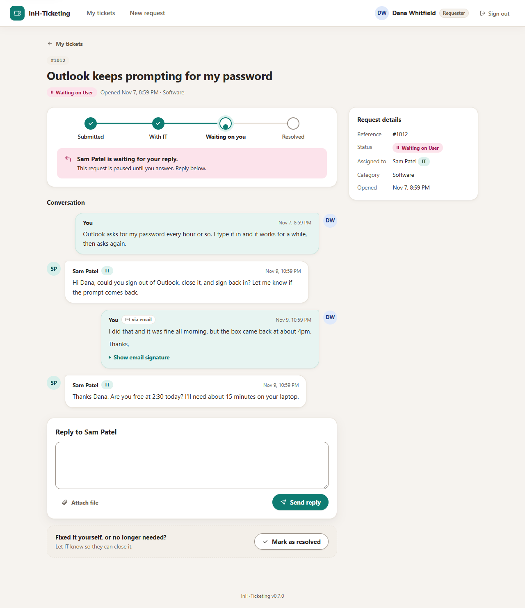

| New request | On a phone |
|---|---|
| 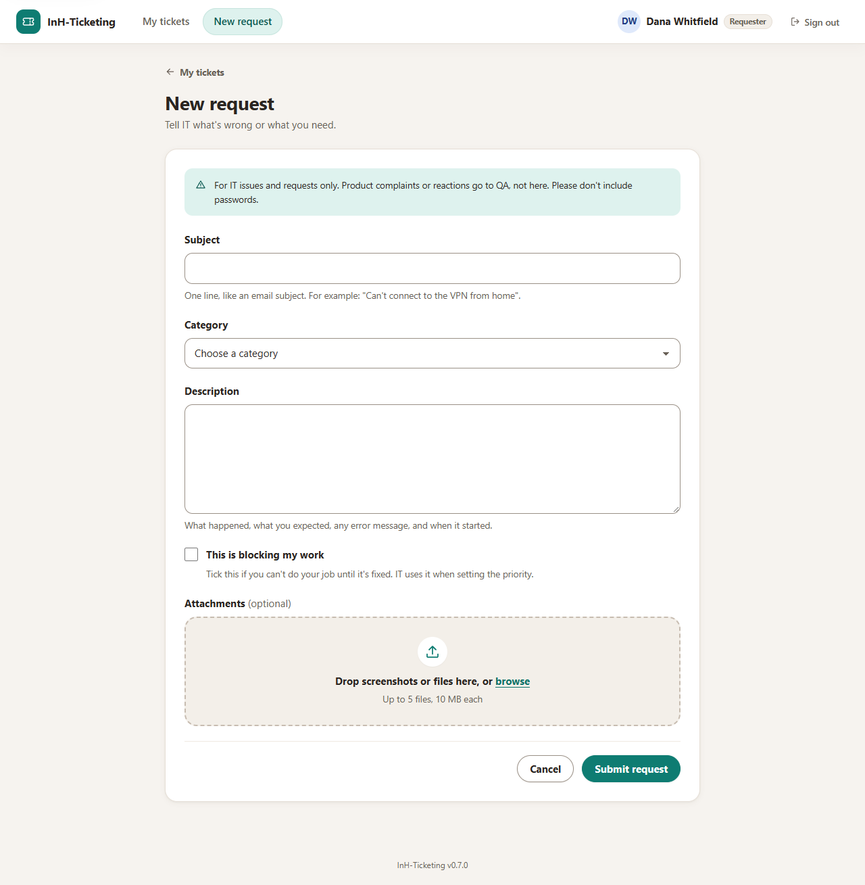 | 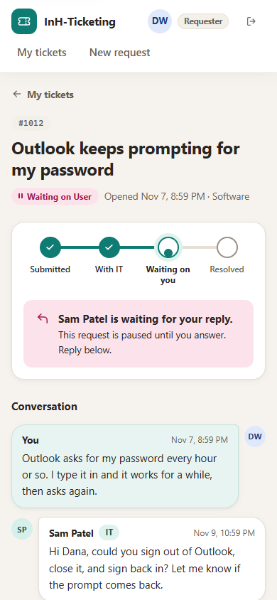 |

### For IT: the queue and the ticket

Queue subjects stay on one line, so every row is the same height; long
subjects end in "..." and show in full on hover. On a phone, each ticket
becomes a card.

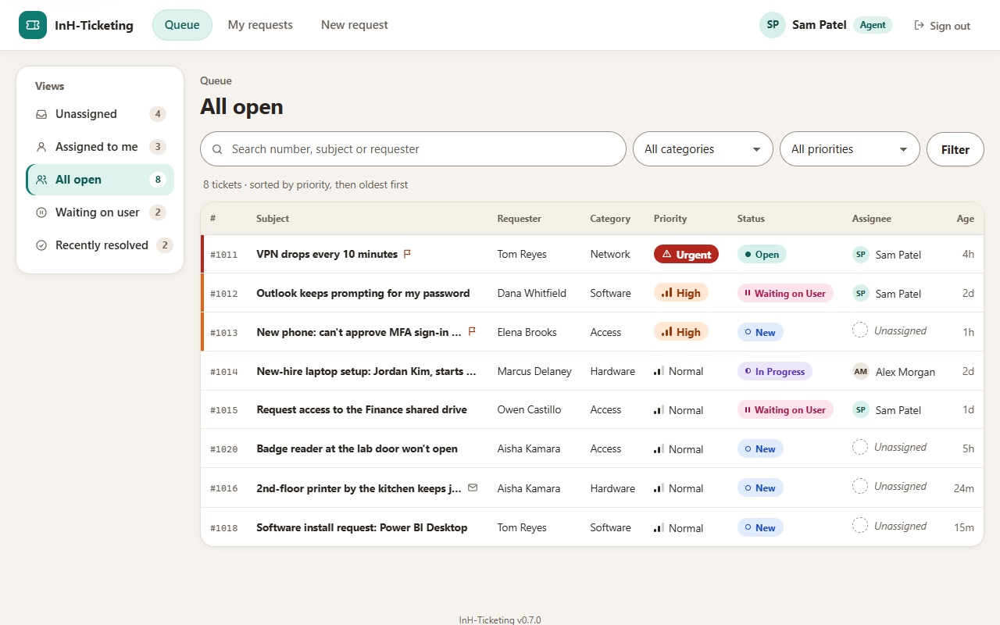

| IT ticket page | Queue on a phone |
|---|---|
| 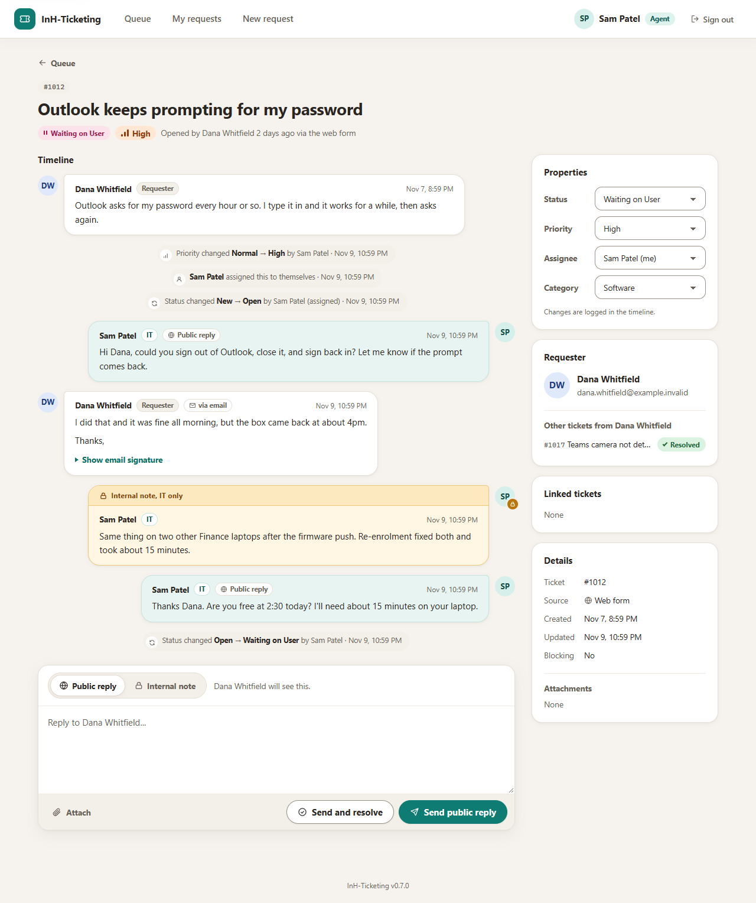 | 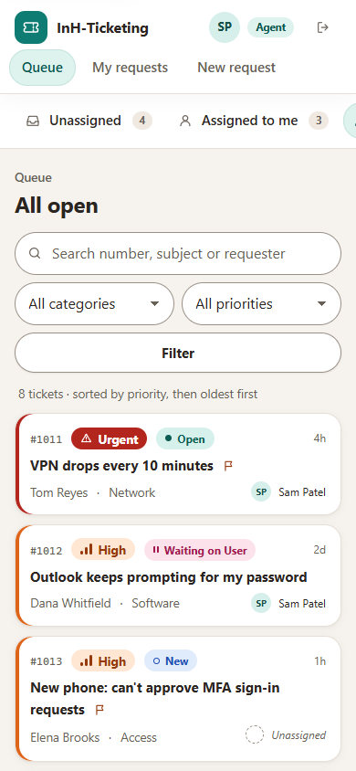 |

| Internal note | "Send and ..." buttons |
|---|---|
| 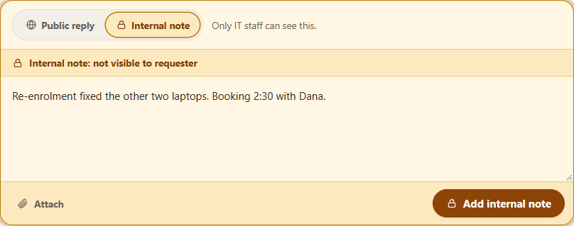 | 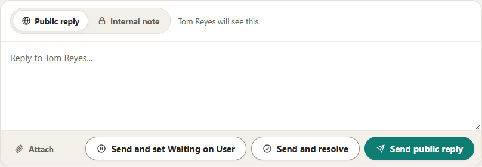 |

The other screens in the new look:
[email from someone else, as an internal note](v0.7.0/13-agent-ticket-email-note.png),
[resolved](v0.7.0/14-requester-resolved.png),
[closed](v0.7.0/15-requester-closed.png),
[starting a follow-up](v0.7.0/16-new-request-follow-up.png),
[linked tickets](v0.7.0/17-agent-linked-tickets.png).

## Warning before a password is sent

The New request form, replies and internal notes check the text before it's
sent. If it might include a password, a PIN or a sign-in code, a warning
appears with a hint of where it is, with the password itself masked. People
take it out, or tick **"It isn't a password, or I need to send it anyway"**.

The check leans towards false alarms on purpose: a wrong warning costs one
click, a missed password ends up in the ticket and in everyone's email. It
stays quiet on everyday IT wording such as "my password expired", "error
code 1603" or "Office365". The page asks the server before sending, so
attached files stay attached, and the server checks again when the form
arrives.

| Staff, new request | IT, public reply |
|---|---|
| 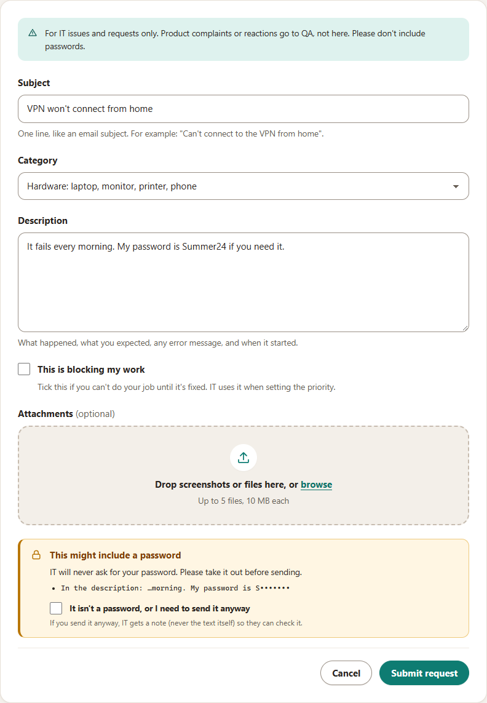 | 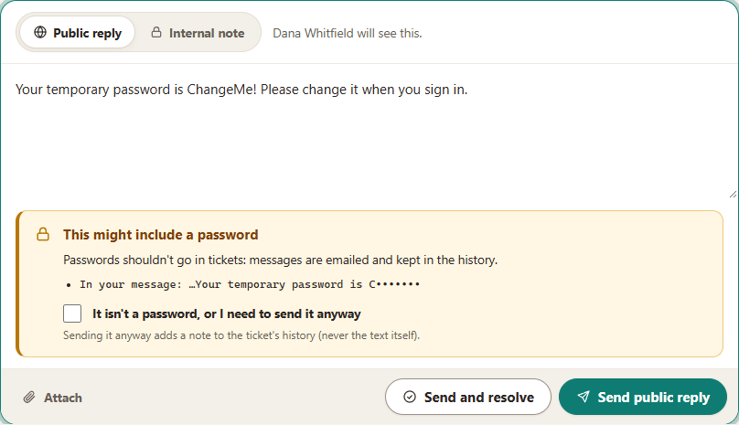 |

### The audit trail

Every "send anyway", every password taken out after a warning, and every
email that looks like it contains one is recorded: who, where, which check,
and what they chose. **The text itself is never stored.** The records are
read-only in **Admin, Password warnings**, and can't be deleted.

When a possible password does go through, IT sees a line in the ticket's
history so they can check it and, per the [usage rules](../usage-rules.md),
reset it. Staff never see history lines.

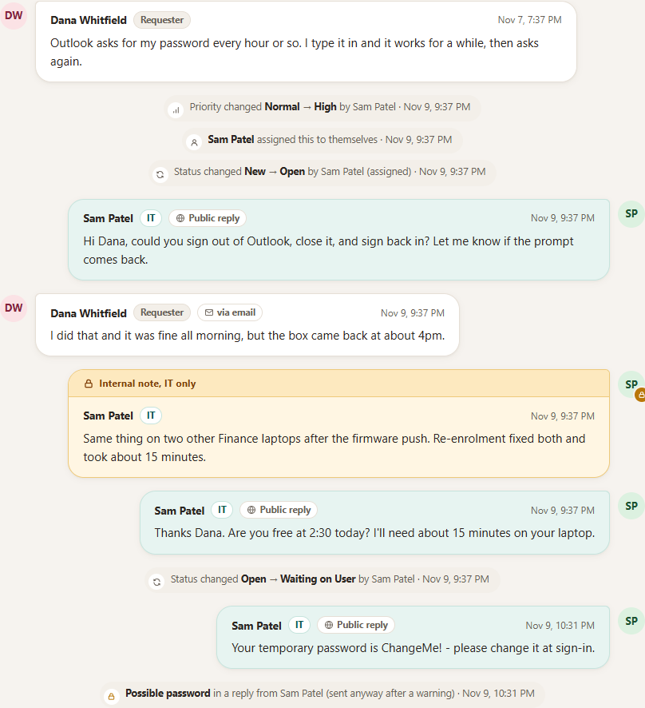

*This screenshot was taken after choosing "send anyway" in the demo.*

## Email signatures fold away

Staff emails carry the CodeTwo signature: name, address, phone and fax, a
logo placeholder, "consider the environment" and the confidentiality notice.
On tickets and replies that arrive by email it now folds under **Show email
signature**, so IT sees the request first and can still open the phone
number. It only folds when it finds at least two signs of a signature, never
on web requests, and the full email is still stored. It works on tickets that
arrived before this version too (check #1071 on the server).

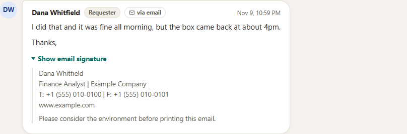

## Also in this version

- The password check ignores file names (`Report_Q3-2024v2.xlsx`) and the
  logo placeholders mail apps put in signatures, which would otherwise have
  flagged nearly every emailed ticket.
- Release screenshots are taken with reduced motion, so an animation never
  shows halfway. The demo data's emailed reply now carries a signature.
- [pilot-testing.md](../pilot-testing.md): the checklist for trying to break
  the system during the pilot.

## Upgrading

Follow [deployment.md](../deployment.md), section 10, with `v0.7.0`. The
update adds one database table (the password audit trail); the `web`
container applies it when it starts. No new `.env` settings.

## Not in this version

- **The tool to remove a pasted password from a ticket.** On the backlog for
  now; it's needed before go-live, so it's planned for v0.8.0 (Nov 18).
- **What happens to closed tickets** after they close is still to decide.
