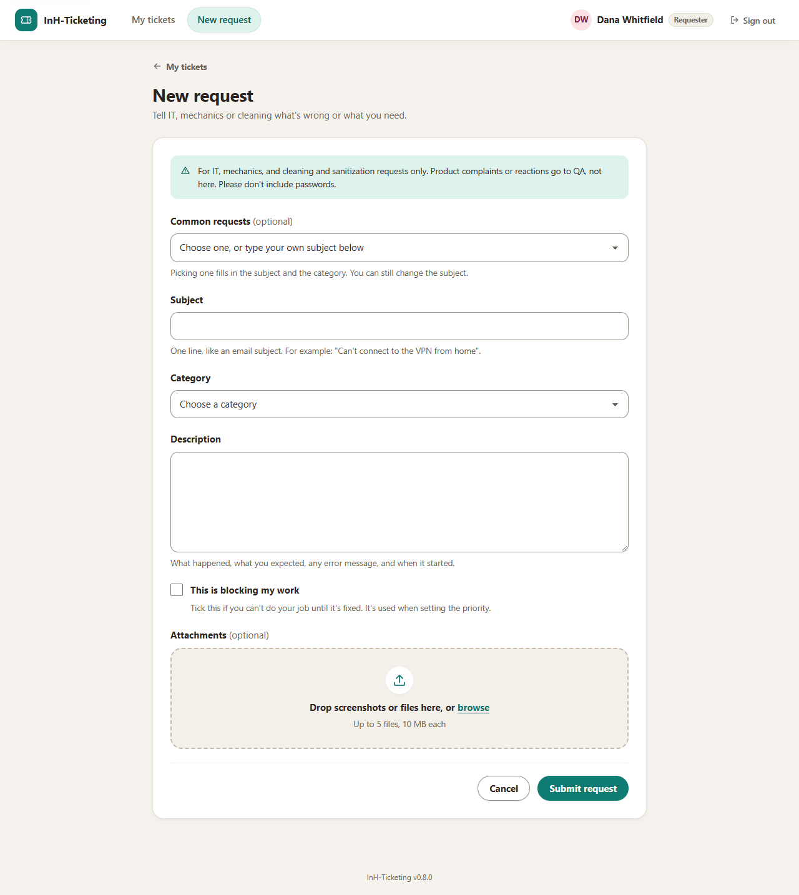
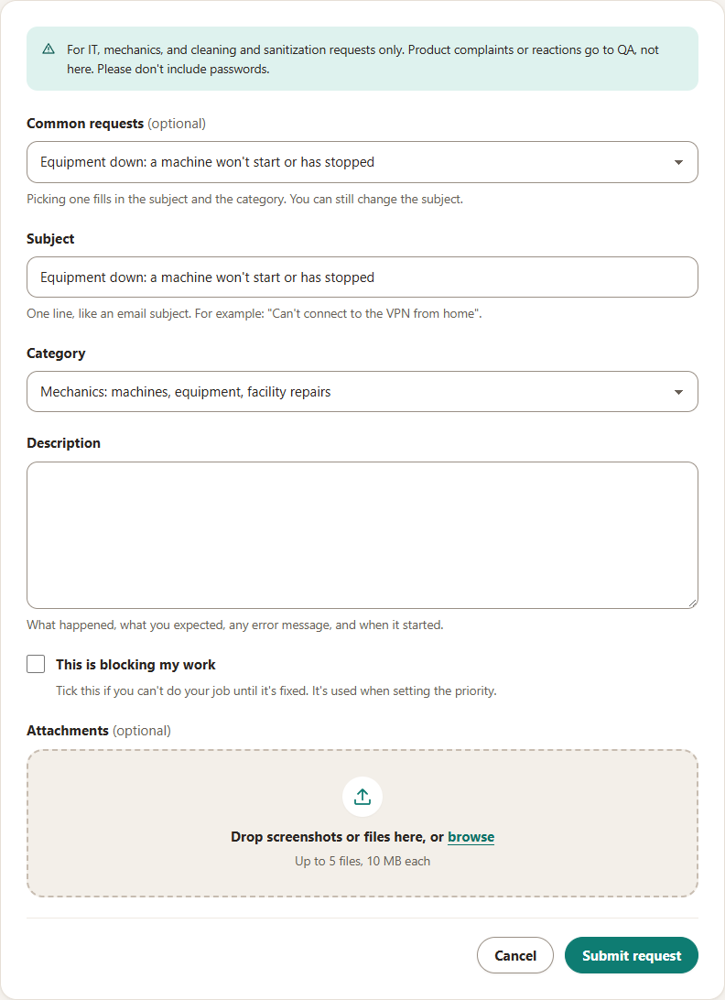
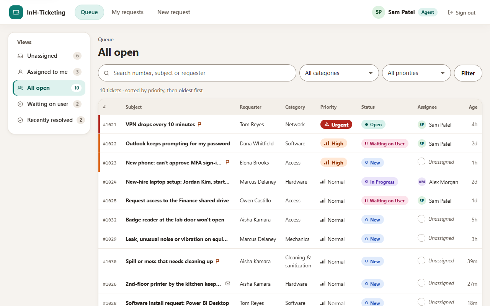
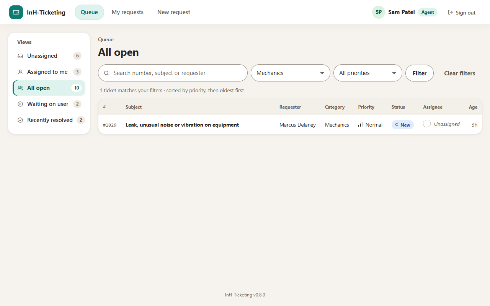

# v0.8.0: Mechanics and cleaning requests, with common requests

**Date:** 2026-11-09
**Built on:** `main`

Staff can now send requests to two more teams, **Mechanics** and **Cleaning &
sanitization**, from the same New request form. Each team has three
**common requests** that fill in the subject and the category in one pick;
people can still type their own. Released for the CFO demo and the pilot on
2026-11-10.

Screenshots use fictional demo data in light mode, with the default settings.
Only the screens that changed are shown.

## Common requests

A **Common requests** list sits at the top of the New request form, grouped
by team. Picking one fills in the subject and the category; the subject can
still be edited, or typed from scratch. It also works without JavaScript: the
server fills them in when the form is sent, and only subjects an admin set up
can be picked.

| Before picking | After picking "Equipment down" |
|---|---|
|  |  |

The starting list, three per team:

| Mechanics | Cleaning & sanitization |
|---|---|
| Equipment down: a machine won't start or has stopped | Spill or mess that needs cleaning up |
| Leak, unusual noise or vibration on equipment | Room or area needs cleaning and sanitizing |
| Facility repair: door, lighting, plumbing or HVAC | Cleaning or sanitizing supplies running low |

**Admins edit the lists** in **Admin, Categories**: open a category and fill in
*Common requests*, one per line (up to 20). Any category can have them, IT's
included. Unticking *Active* hides a category and its common requests.

The page's notice now reads "For IT, mechanics, and cleaning and sanitization
requests only". The QA and password lines are unchanged.

## In the queue

Mechanics and Cleaning & sanitization tickets land in the same queue as IT's,
for now. The category filter shows one team's tickets, and long category
names wrap instead of widening the table.

## Before turning it on for everyone

- **Who works these tickets.** Only IT can reply today. Giving Mechanics and
  Cleaning & sanitization their own queue and role, so they don't see IT's
  tickets and internal notes, is planned for v1.2.0 ([roadmap](../roadmap.md)).
- **The usage rules.** [usage-rules.md](../usage-rules.md) still says IT
  only. The compliance lead said these requests needn't go through the FDA rules,
  as no customer data is involved. The usage rules and the risk assessment
  will be updated after the review with him on 2026-11-10.
- **More common requests and a self-fill option** will follow, once they're
  gathered from the teams.

## Upgrading

Follow [deployment.md](../deployment.md), section 10, with `v0.8.0`. Migration
`tickets 0005` adds the common requests and the two categories; the `web`
container runs it when it starts. No new `.env` settings. Updating straight
from v0.6.0 also brings in everything from [v0.7.0](v0.7.0.md).
