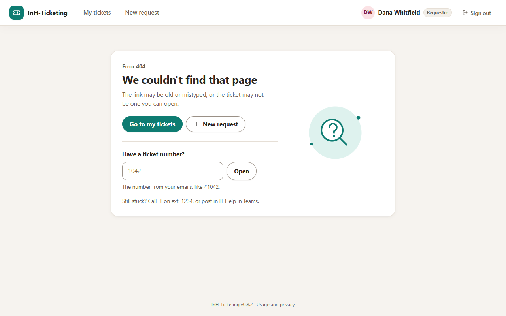
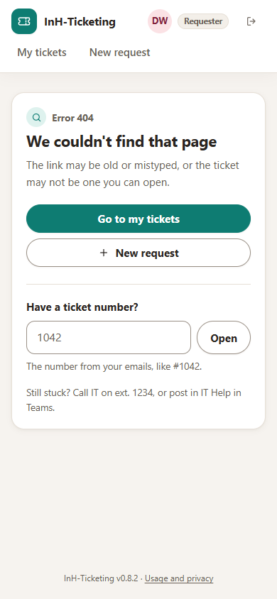
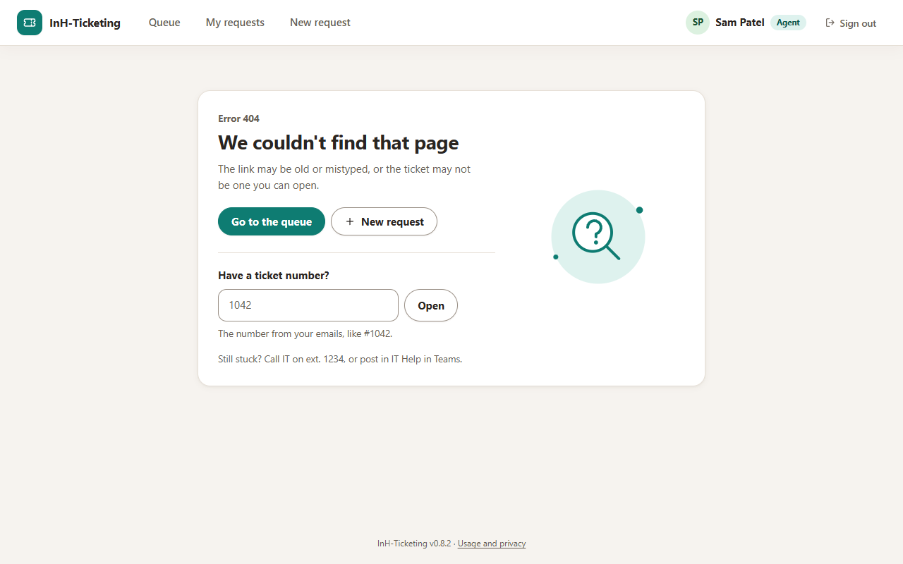
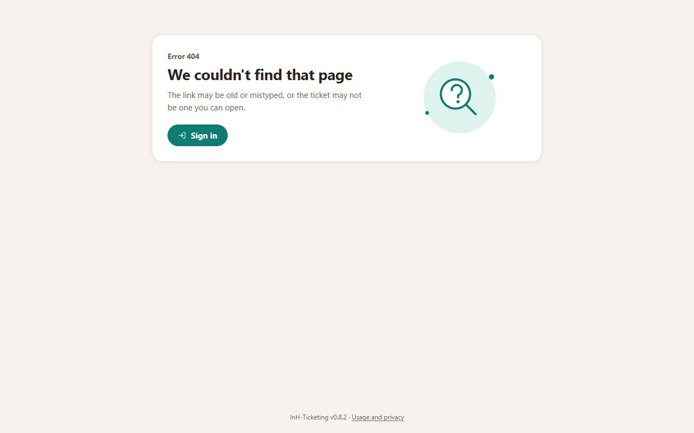
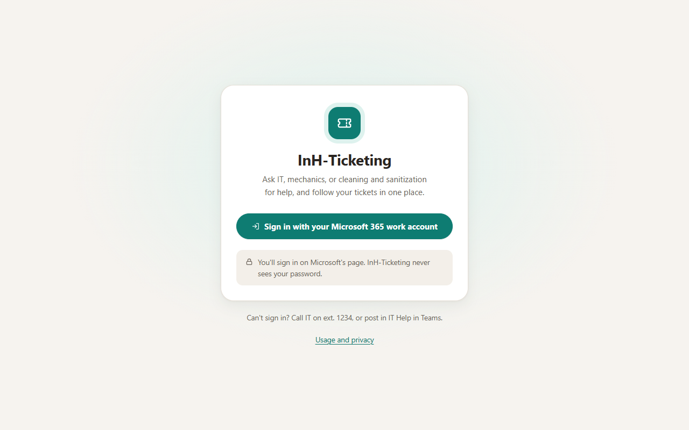
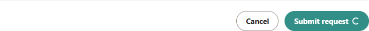
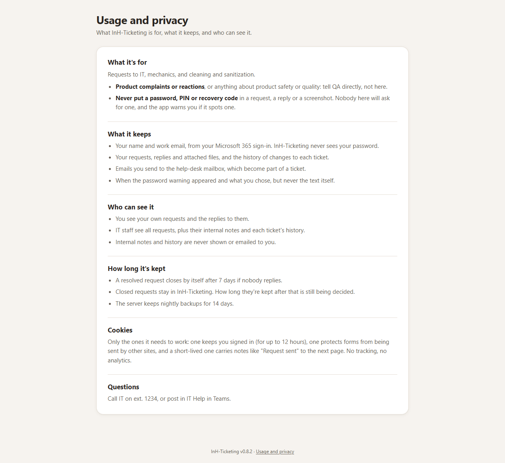

# v0.8.2: The basics: Not found page, help contact, no double sends, usage and privacy, favicon

**Date:** 2026-11-09
**Built on:** `main`

The basics an app needs when something goes wrong, from a review of common
website basics against what an internal, sign-in-only app actually needs
([roadmap](../roadmap.md), Site basics). v0.8.1 was skipped: the Not found page
was going to ship on its own as v0.8.1, and these fixes joined it.

Screenshots use fictional demo data in light mode. The help contact shown is
an example (`HELP_CONTACT=Call IT on ext. 1234, or post in IT Help in Teams.`).

## A Not found page with next steps

The old page had one "Back to home" button. Now staff get **Go to my
tickets**, IT gets **Go to the queue**, everyone signed in gets **New
request**, and a **Have a ticket number?** box opens a ticket directly. The
same page shows for a ticket that isn't yours, so the wording never says
whether a ticket exists.

| On a phone | For IT | Signed out |
|---|---|---|
|  |  |  |

## Who to contact when the app can't help

Until now, someone who couldn't sign in saw "Contact IT", with no way to do
it. A new `.env` setting, `HELP_CONTACT`, says how: it shows under "Can't sign
in?" and on the sign-in problem, No access, Not found and Something went wrong
pages. Left blank, it says "Email IT at" the help-desk mailbox, or "Contact
IT." if that's blank too. The Something went wrong page reads settings only,
never the database, so it still works when the database is what failed.

## No more double-sent requests

The button you press shows a small spinner while the form sends, and a
second click is ignored, so a double click can't create two tickets or two
replies. (Checked in Edge: a double click on **Submit request** made one
ticket.) It works with the password check: the button only shows as sending
once the check has let the form go.

## Wording for every team

Now that Mechanics and Cleaning & sanitization use the app too, nothing tells
their requesters "IT will pick it up". The confirmation reads **"Request
#1042 sent. You'll get an email when there's an update."**, the tracker's
second step is **Being worked on**, and the sign-in page, My tickets and the
password warning name no single team.

## Usage and privacy

A short page, open to everyone and linked from the footer and the sign-in
page: what the app is for, what it keeps, who can see it, how long it's kept,
and its cookies (only the ones it needs; no tracking, no analytics).

## Also in this version

- **Favicon set:** the app's ticket mark in browser tabs and on phone home
  screens, with a web manifest. `/favicon.ico` points at it.
- **Kept out of search engines:** `/robots.txt` disallows everything, and
  every page says `noindex, nofollow`.
- The hidden "Skip to content" link's shadow no longer peeks in at the top of
  signed-out pages.

## Upgrading

Follow [deployment.md](../deployment.md), section 10, with `v0.8.2`. No
database changes. Set `HELP_CONTACT` in the server's `.env` first (see
`.env.example`), for example IT's extension and Teams channel.

## Not in this version

- A fuller privacy notice, needed before licensing to other companies.
- The tool to remove a pasted password from a ticket (v0.9.0).
