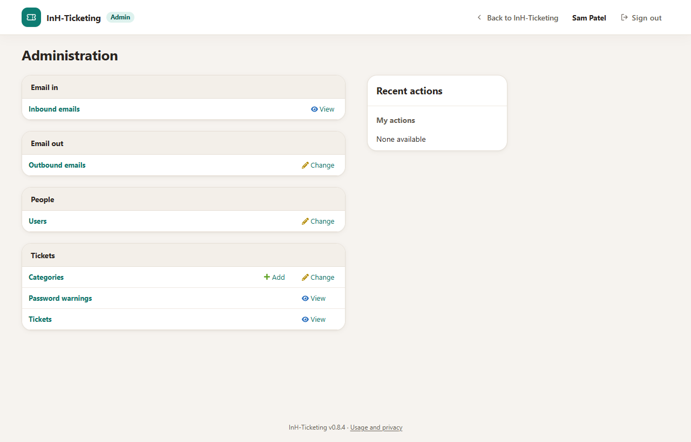
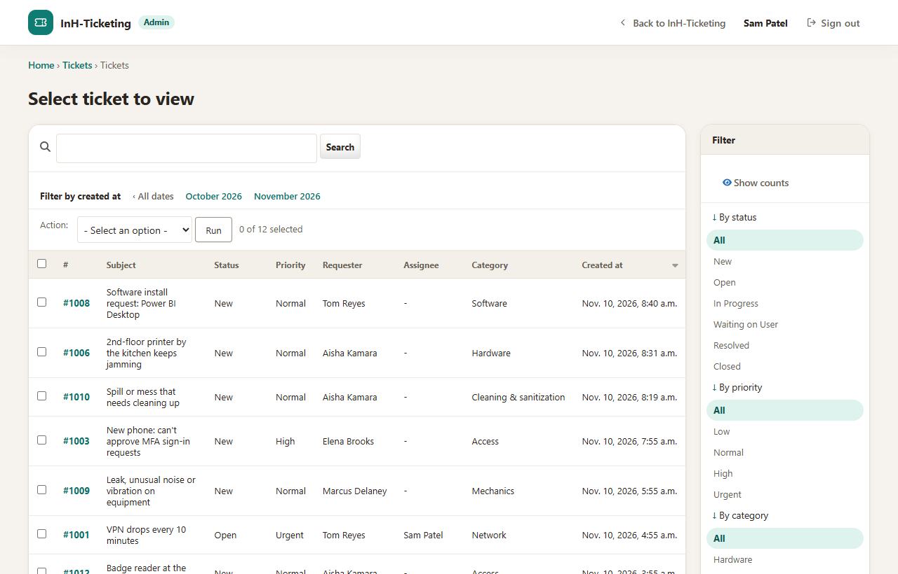
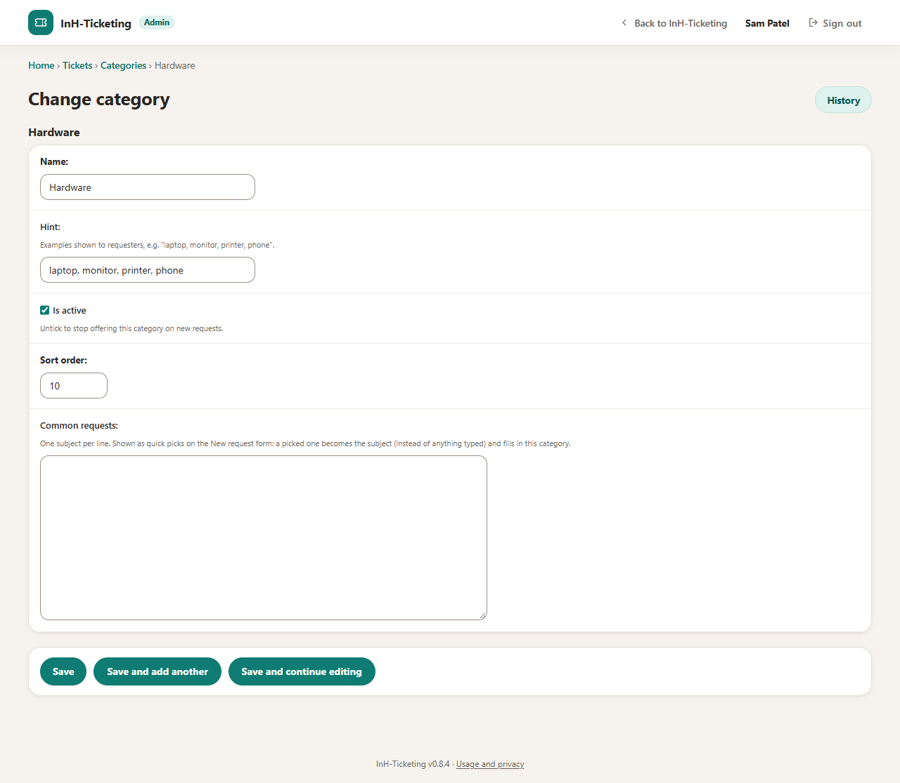
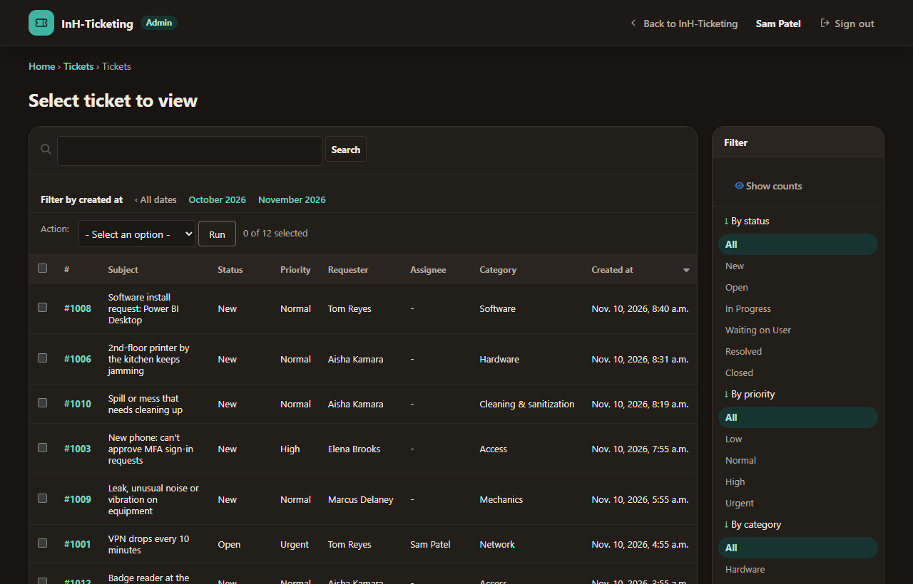
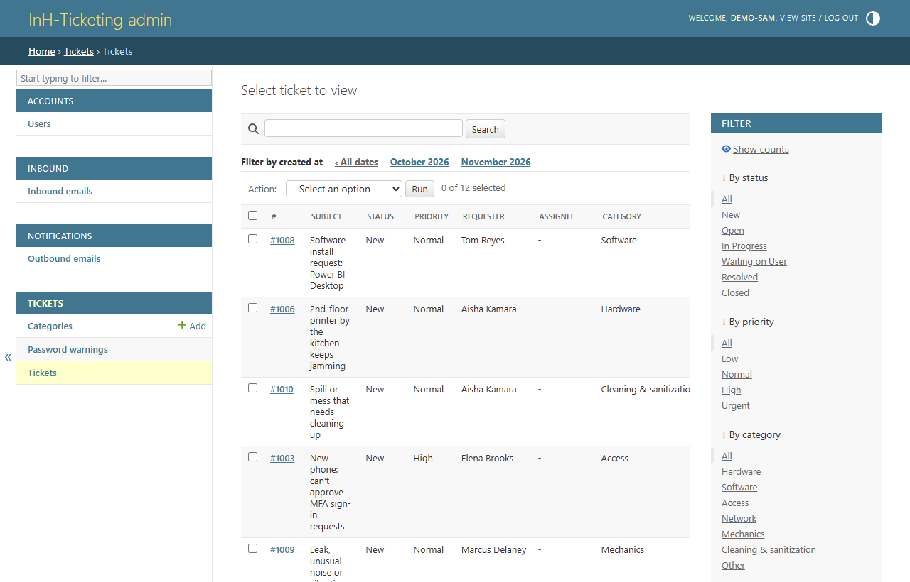
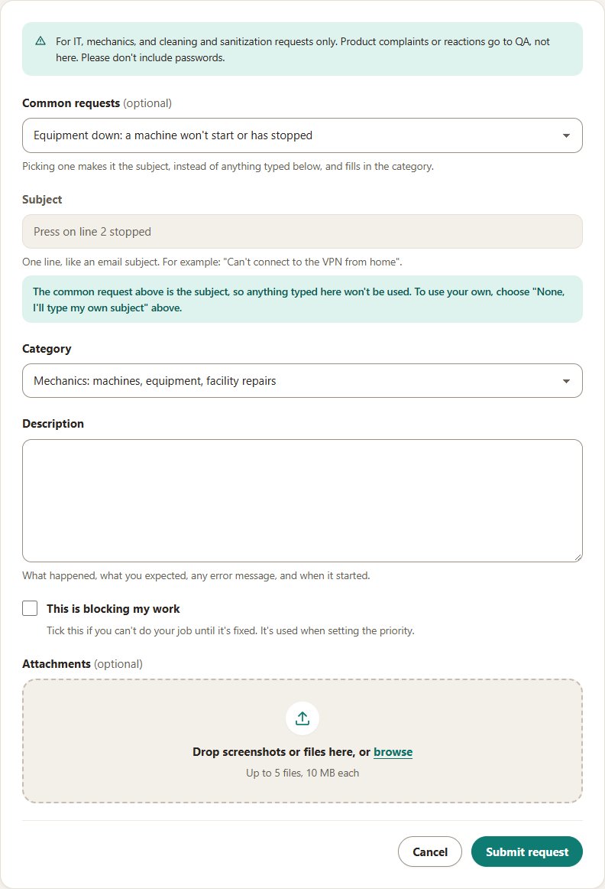

# v0.8.4: The admin in the app's look, and common requests as the subject

**Date:** 2026-11-10
**Built on:** `main`

Two changes asked for on 2026-11-10: the admin site looked like a different
app, and a common request could lose out to a subject someone had typed.
Screenshots use fictional demo data.

## The admin site, in the app's look

The admin site (`/admin/`, for admins only) was Django's stock blue and yellow.
It now looks like the rest of InH-Ticketing: the same white header with the
app's mark and an **Admin** tag, the warm background, rounded cards, teal pill
buttons and rounded fields, and tables like the IT queue.

Also:

- **Back to InH-Ticketing** and **Sign out** in the header. Sign out works
  the same as everywhere else in the app, so it no longer lands on Django's
  own "Logged out" page.
- **No sidebar.** Six lists don't need one; the admin home and the
  breadcrumbs cover it, and the ticket list gets the full width.
- **Plainer names:** the sections are now People, Email in, Email out and
  Tickets (they were Accounts, Inbound, Notifications and Tickets).
- **Light or dark follows the device,** like the rest of the app, so Django's
  own theme switch is gone.
- Links in tables, lists and the filters aren't underlined (they are on
  hover), and rows aren't striped, like the queue.

| The ticket list | Editing a category |
|---|---|
|  |  |

| Dark mode | Before |
|---|---|
|  |  |

The colours live in `static/css/admin.css`, which repeats the app's tokens
(Django's admin uses some of the same variable names, so it can't load
`app.css`). A company theme changes both files.

## A common request is the subject

Before, a common request filled in the subject, but a subject typed over it
won. Now a chosen common request **is** the subject:

- The subject box greys out. What was typed stays there, in case they change
  their mind.
- A note under it says so: "The common request above is the subject, so
  anything typed here won't be used."
- Choosing **None, I'll type my own subject** (the picker's first option,
  renamed) brings the typed subject back.
- The category still fills in, and a category the person chooses afterwards
  still wins.
- The password check skips the greyed-out subject, since it isn't sent.

Without JavaScript the box can't grey out, so the hint under the picker says
it too: "Picking one makes it the subject, instead of anything typed below".
The server uses the common request either way. The admin's help text for
common requests says the same.

## Upgrading

Follow [deployment.md](../deployment.md), section 10, with `v0.8.4`.

One migration, `tickets` 0006, which only rewords the help text for common
requests in the admin: it changes nothing in the database (no SQL). Rolling
back to v0.8.3 needs no restore: check out `v0.8.3` and rebuild.

## Tests

291 automated tests, all passing: new ones for the admin's look (the
stylesheet, the header, the app's sign-out, no theme switch, no sidebar, the
section names) and for common requests (the pick wins over a typed subject,
the chosen category still wins, the box comes back greyed out with the note).
Both changes were also checked in Edge, light and dark, desktop and phone.
