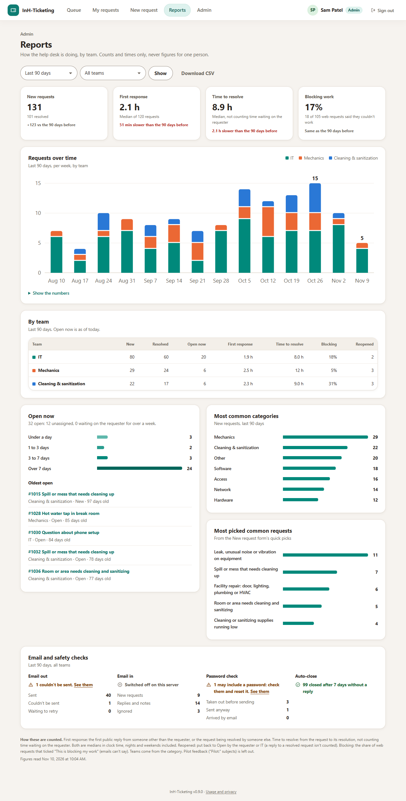
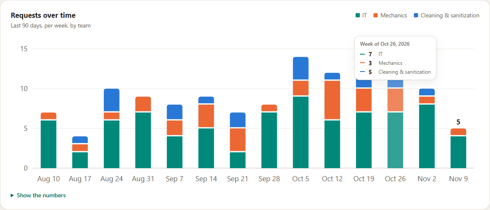
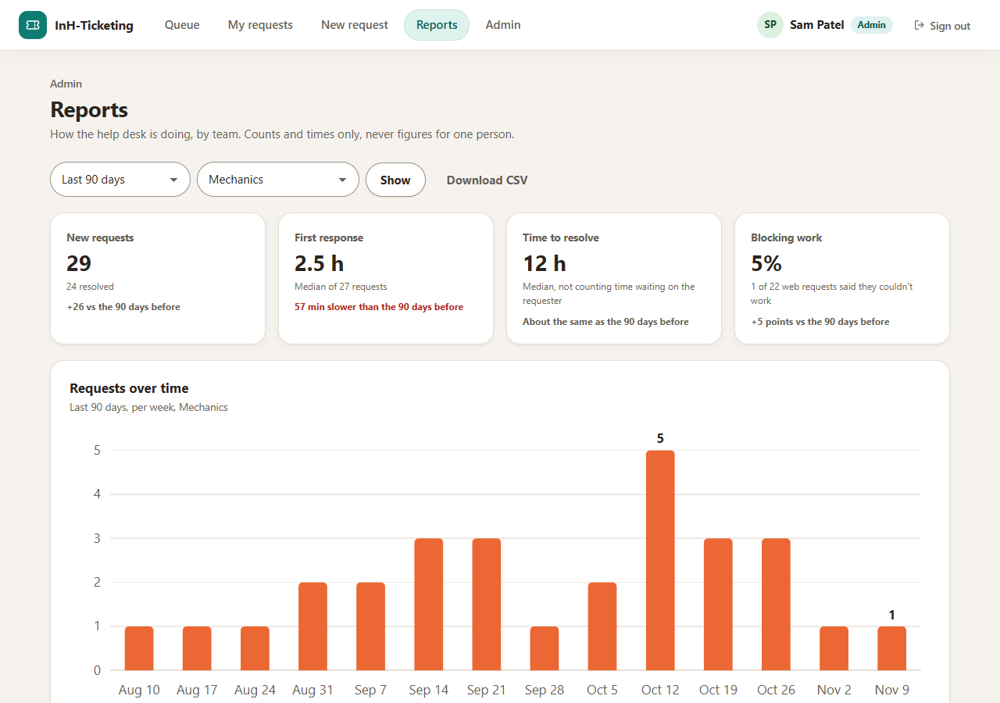
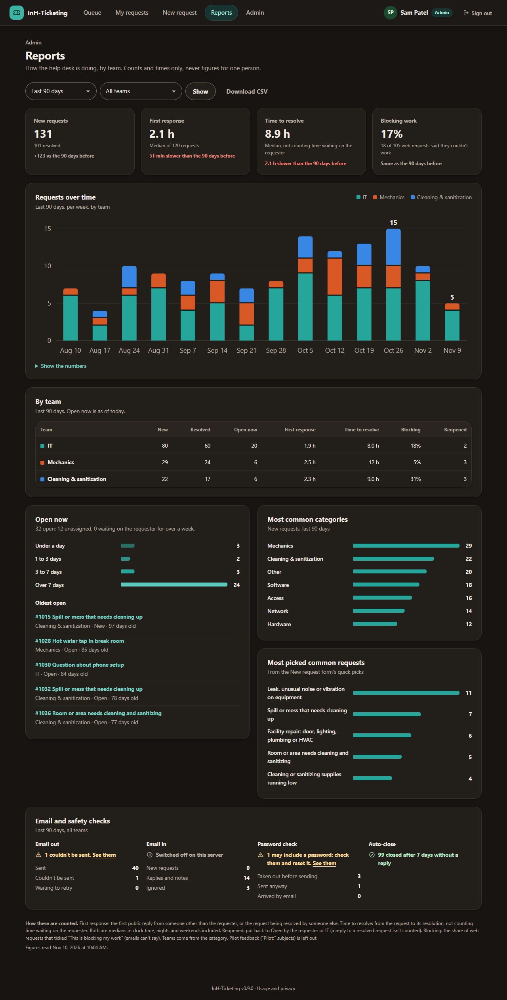

# v0.9.0: Reports, for admins

**Date:** 2026-11-10
**Built on:** `main`

A Reports page for admins: how the help desk is doing, by team. It was
planned for v1.1.0 and is built early. What it shows was chosen from three
research passes: day-to-day IT operations, compliance and privacy, and what
management and the departments need.

Counts and times only, per team, **never figures for one person**: with two
people in IT, any per-person number would be staff monitoring. Everything is
read from records the app already keeps; nothing new is collected, and there
is no tracking.

Screenshots use about three months of made-up tickets, so the numbers are
fictional.

## Where it is, and who sees it

`/reports/`, linked as **Reports** in the header (next to Admin) and in the
admin site's header. **Admins only:** agents and requesters get "No access".
The page and its download are never cached, like the admin site.

## What's on it

A period (last 7 days, 30 days, 90 days or 12 months) and a team (IT,
Mechanics, Cleaning & sanitization, or all) at the top scope everything
below them.

- **Four headline numbers**, each against the period before:
  - **new requests** (and how many were resolved)
  - **first response**: the median time to the first public reply from
    someone other than the requester
  - **time to resolve**: the median, not counting time waiting on the
    requester
  - **blocking work**: the share of web requests that ticked "This is
    blocking my work"

  Faster reads green and slower red, always with the words too.
- **Requests over time:** per day, week or month, stacked by team. Hover or
  tab to a column for its numbers; "Show the numbers" has them as a table.

  

- **By team:** new, resolved, open now, first response, time to resolve,
  blocking share and reopened, one row per team.
- **Open now:** open requests by age (under a day to over a week), how many
  are unassigned or waiting on the requester for over a week, and the five
  oldest.
- **Most common categories** and **most picked common requests** (from the
  New request form's quick picks).
- **Email and safety checks:**
  - **email out:** sent, couldn't be sent, waiting to retry, and a warning
    if the email worker seems to have stopped
  - **email in:** new requests, replies, ignored, and any it couldn't read
  - **password check:** warnings, and what happened with each
  - **auto-close:** how many tickets were closed

  Each problem links to the matching list in the admin site.
- **Download CSV:** one row per request in the period, for a spreadsheet:
  number, dates, team, category, priority, source, status, blocking, first
  response and time to resolve. No descriptions and no names. A cell that
  starts like a formula (`=`, `+`, `-`, `@`) is shown as text, never run.

| One team (colours stay with the team) | Dark mode |
|---|---|
|  |  |

## How it's counted

- **Teams come from the category** until v1.2.0 gives each category a
  department: Mechanics, Cleaning & sanitization, and everything else is IT.
- **First response:** a public reply from someone other than the requester,
  or the request being resolved or closed by someone else. Internal notes
  and the requester's own replies don't count.
- **Time to resolve:** from the request to its last resolution, minus time in
  Waiting on User and time already resolved before a reopen.
- **Reopened:** put back to Open by the requester ("This is still a problem")
  or by IT. A reply to a resolved request also reopens it, but thank-you
  replies would inflate that, so those aren't counted.
- **Times are clock time**, nights and weekends included (there are no
  business hours yet).
- **Pilot feedback** (subjects starting "Pilot:") is always left out.

## Charts

The charts are drawn on the server as SVG: no chart library and nothing
loaded from outside, so they work offline on the internal server and keep
working under a future Content-Security-Policy. They follow dark mode.

The team colours are teal, orange and blue, in a fixed order. They were
checked for colour-blind separation and contrast on the card in both modes.
The age bars use one teal, lighter to darker.

## Privacy

The usage and privacy page has one new line under "Who can see it": "Admins
also see reports made from the requests: counts and times per team, never
figures for one person." Nothing else changes: no new cookies, no tracking.

## New setting

`REPORTS_FROM` (in `.env`): the date the reports count from, e.g. the
go-live date, so pilot and test tickets before it are left out. Blank counts
every ticket. See `.env.example` and [deployment.md](../deployment.md),
section 5.

## Upgrading

Follow [deployment.md](../deployment.md), section 10, with `v0.9.0`. No
database changes. Rolling back to v0.8.4 is a checkout and rebuild.

## Tests

315 automated tests, all passing. The 24 new ones cover:
- **access:** admins only; agents and requesters get 403; nothing is cached
- **counting:** the response and resolve times, teams, pilot tickets and
  `REPORTS_FROM`
- **time zones:** a request at 23:30 on Oct 31 in Los Angeles counts in
  October
- **the rest:** reopens, the blocking share, open-ticket ages, common
  requests, the email and password checks, the CSV (formula cells, no
  descriptions or names) and the chart's axis and colours

Checked in Edge in light, dark and on a phone, with nothing scrolling sideways.

## Not in this version

- **Response targets** per priority ("% answered within target"): v1.1.0.
- **Requests by the requester's own department:** needs Entra's `department`
  value stored at sign-in.
- **The pilot fixes, the removal tool for a pasted password and the
  closed-ticket decision** wait for the pilot's testing.
  - Before v1.0.0, the closed-ticket decision must keep each closed ticket's
    record, or Reports loses its history ([backlog](../backlog.md)).
