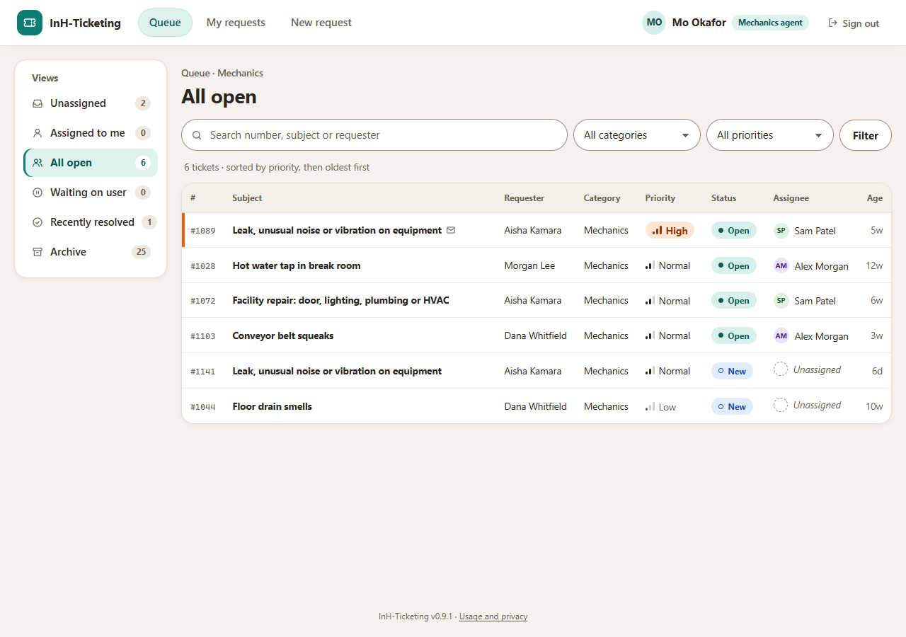
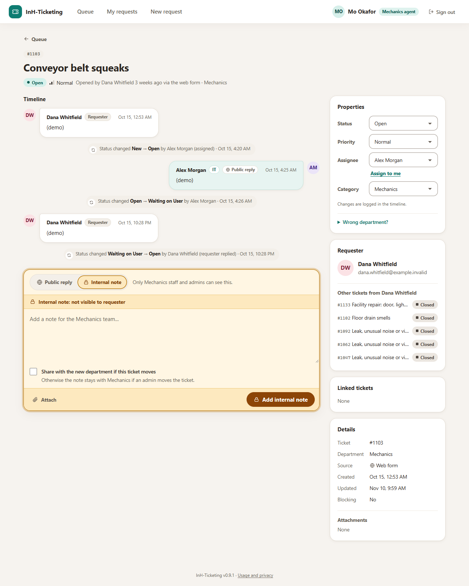
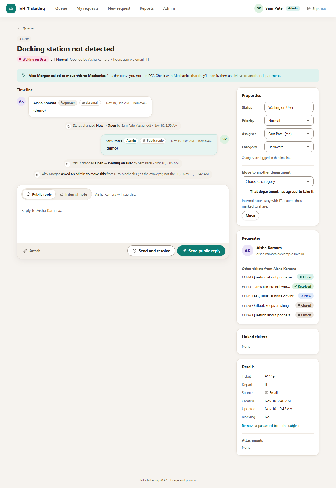
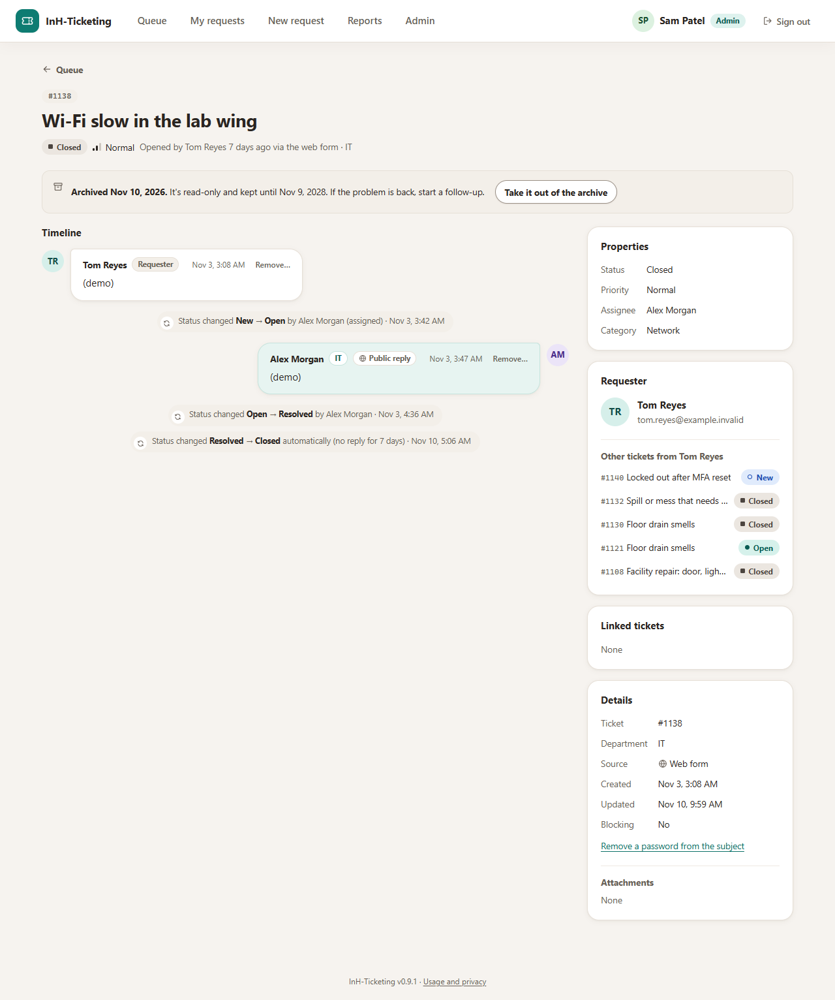
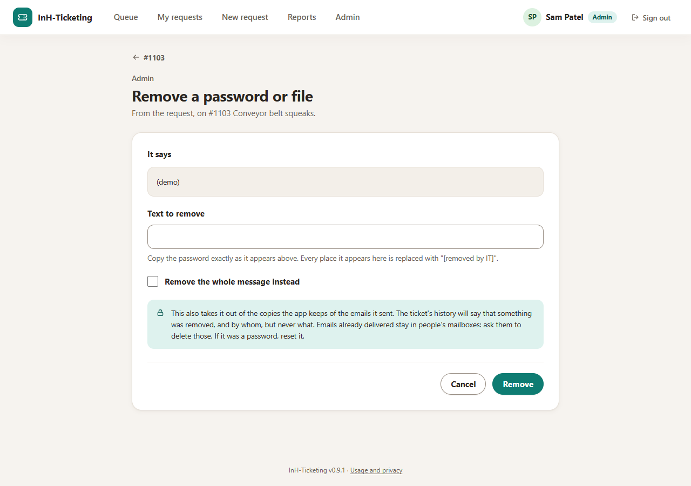

# v0.9.1: Before go-live: departments, the archive, removing passwords, and safety fixes

**Date:** 2026-11-10
**Built on:** `main`

Everything the reviews said was needed before go-live, plus three decisions
from 2026-11-10:

- Closed tickets are archived (for two years; deleting them after that comes later).
- Mechanics and Cleaning & sanitization see and work their own tickets.
- The department mailboxes are ready to switch on when the CFO decides.

Screenshots use fictional demo data.

**Before installing, read [Upgrading](#upgrading):** from this version,
agents see only their own department's tickets.

## Departments: each team works its own tickets

Each category now belongs to a department: IT, Mechanics, or Cleaning &
sanitization (the admin site shows and sets it). Staff get their department
from their Entra app role:

| Entra role | Sees and works |
|---|---|
| `Agent` | IT's tickets |
| `Agent.Mechanics` | Mechanics' tickets |
| `Agent.Cleaning` | Cleaning & sanitization's tickets |
| `Admin` | Every department's, with a department filter on the queue |

- **Agents see only their department's tickets:**
  - the queue and its search
  - "other tickets from this requester"
  - linked tickets and files
  - a ticket from another department shows Not found
- **Their own requests:** staff still see the requests they made themselves to
  other teams, as a requester sees them.
- **Changes stay in the department.** Agents change status, priority and the
  assignee as before. Categories and assignees stay within the department.
- **Wording:** "Mechanics staff and admins can see this", "Add a note for the
  Mechanics team", a "Mechanics agent" tag in the header, and the department
  in the ticket's details.
- **New-request alerts** go to the ticket's department: `IT_NOTIFY_EMAIL` for
  IT. For the others, their address in `DEPARTMENT_NOTIFY_EMAILS`, or else
  each of that department's agents.

### Wrong department? Only an admin moves it

- **Asking for a move:** an agent opens "Wrong department?", chooses where it
  should go and says why. Every admin gets an email, and the ticket shows the
  request until it's moved.
- **Moving it:** the admin checks with the other team outside the app (by
  phone, Teams or email), then uses **Move to another department** and ticks
  "That department has agreed to take it".
- **The history** records who asked, who moved it, from and to, that it was
  confirmed, and how many notes went with it.
- **The assignee:** if they don't work for the new department, the ticket is
  unassigned.

### Internal notes stay with their department

Each internal note belongs to the department that wrote it. If the ticket
moves, the new department sees only the notes marked **Share with the new
department if this ticket moves**, which is off by default. The others stay
with the original department and are never deleted. Admins see every note.

## Closed tickets are archived

Closing a ticket now archives it, whether IT closes it or it closes by itself
after 7 days.

- **Read-only:** no replies, no changes, and it's gone from the working queue
  views. A new **Archive** view lists archived tickets.
- **Kept for two years:** the ticket shows the date. Deleting a ticket when its
  time is up isn't switched on yet, so nothing is deleted.
- **If the problem is back:** the requester starts a follow-up, or replies to
  the email, which starts one automatically.
- **Emails about it:** an email from staff about an archived ticket is kept on
  it as an internal note.
- **Mistakes:** an admin can **Take it out of the archive** if it was closed by
  mistake.
- **Upgrading:** tickets that are already closed are archived when you
  upgrade.
- **Reports:** archived tickets still count, so Reports keeps its history.

## Removing a pasted password or file

On a ticket, admins have **Remove…** on every message, and **Remove a password
from the subject** in the details. It opens a page showing the message. Paste
the password exactly as it appears, and every place it appears there is
replaced with "[removed by IT]". You can also remove the whole message, or any
of its files.

- **The app's own copies:** the password is also taken out of the copies the
  app keeps of the emails it sent (subjects, text and HTML), and out of the
  subjects of emails it received.
- **The history** says that something was removed, by whom and when, never
  what.
- **Emails already delivered** stay in people's mailboxes. The page says to ask
  them to delete those, and to reset the password.

## Safety fixes from the reviews

- **Fake "IT" emails.** An email that only claims to be from IT used to become
  a public IT reply. Now it needs Exchange to confirm the sender. Either it
  was sent inside the organisation (`AuthAs: Internal`, a header Exchange
  strips from outside email), or it passed DMARC or Microsoft's composite
  authentication. Otherwise it's kept as an internal note marked "Exchange
  couldn't confirm it really came from them", and the requester never sees
  it. `INBOUND_VERIFY_IT_SENDERS` can turn the check off if Exchange doesn't
  add those headers here.
- **Shared PCs:**
  - Signed-in pages and downloads are never kept by the browser
    (`Cache-Control: private, no-store`), so the Back button after signing
    out can't bring someone's tickets back.
  - Signing in now lasts until the browser closes, and 12 hours at most.
- **No deleting tickets** in the admin site, as the usage rules say.
- **Start-up order:** the worker waits until the web container has applied
  the database updates and is answering.
- **The web manifest** is served as `application/manifest+json`.
- **The usage and privacy page** now says:
  - that ignored emails are logged with their sender and subject
  - that the app keeps a copy of each email it sends
  - who sees what, by team
  - that closed requests are archived and kept for two years
  - how long signing in lasts

## A mailbox per department, ready to switch on

`DEPARTMENT_MAILBOXES` gives Mechanics and Cleaning & sanitization their own
mailbox. Email to it becomes a ticket for that department, and that
department's tickets are emailed from it, so replies come back to the right
team. It works either way the CFO decides:

- **a new, request-only mailbox**: the app reads its Inbox
  (`mechanics=mechanics-requests@mckennalabs.com`)
- **the existing mailbox, with a rule that files requests into a folder**: the
  app reads only that folder (`cleaning=cs@mckennalabs.com/Requests`)

Each mailbox needs the Exchange steps in [email-setup.md](../email-setup.md),
4d. Until it's set, nothing changes. A mailbox that isn't set up yet doesn't
stop the others.

## Upgrading

Follow [deployment.md](../deployment.md), section 10, with `v0.9.1`.
Migrations `tickets` 0007 and `accounts` 0002 run when the `web` container
starts:
- Mechanics and Cleaning & sanitization get their departments, and every
  other category is IT's.
- Today's agents become IT agents.
- Existing internal notes belong to their ticket's department.
- Closed tickets are archived.

**Before installing:**

1. **In Entra, create the `Agent.Mechanics` and `Agent.Cleaning` app roles**
   ([entra-setup.md](../entra-setup.md), section 3) and assign each team's
   group to its own role. Never give them the plain `Agent` role.
2. **Know what changes for IT.** Tickets in the Mechanics and Cleaning &
   sanitization categories leave IT agents' queues (admins still see them).
   Any of them assigned to an IT agent stay assigned to them, out of their
   sight. An admin can reassign them to that department's staff once they
   sign in.
3. Leave `DEPARTMENT_MAILBOXES` blank until the mailboxes are decided.

Rolling back: see deployment.md section 10, "From v0.9.1 back to v0.9.0".

## Tests

356 automated tests, all passing. The 41 new ones cover:
- **fake IT emails:** what counts as a confirmed sender, and that unconfirmed
  "IT" emails become notes
- **shared PCs:** no-store, and sign-in ending when the browser closes
- **the safety fixes:** no ticket deletes, the start-up order, the manifest,
  the privacy page
- **the archive:**
  - closing and auto-closing archive
  - archived tickets are read-only
  - the Archive view
  - only admins take tickets out of the archive
  - emails about an archived ticket
  - tickets closed before the upgrade are archived
- **departments:**
  - Entra roles to departments
  - each department sees only its own tickets
  - admins see all and can filter
  - staff can't move tickets out
  - assignees come from the department
  - staff see their own requests as requesters
  - alerts go to the department
- **moves:** asking, moving with confirmation, unassigning, and notes staying
  with their department unless shared
- **department mailboxes:** the setting, new tickets from them, ignoring
  their own mail, sending from them, and reading a folder
- **removal:** admins only, the text, the subject, a whole message, files, and
  the email copies scrubbed

The new screens were also checked in Edge as an admin, an IT agent and a
Mechanics agent.

## Not in this version

- **Deleting archived tickets** two years after archiving. They're kept until
  then; the date is on each ticket.
- **The department mailboxes' addresses**, waiting on the CFO. The setting is
  ready.
- **A worker heartbeat** for Reports. It still infers a stopped worker from
  emails waiting to be sent.
- **More in-depth common requests and a self-fill option** for Mechanics and
  C&S (the owner is gathering them).
