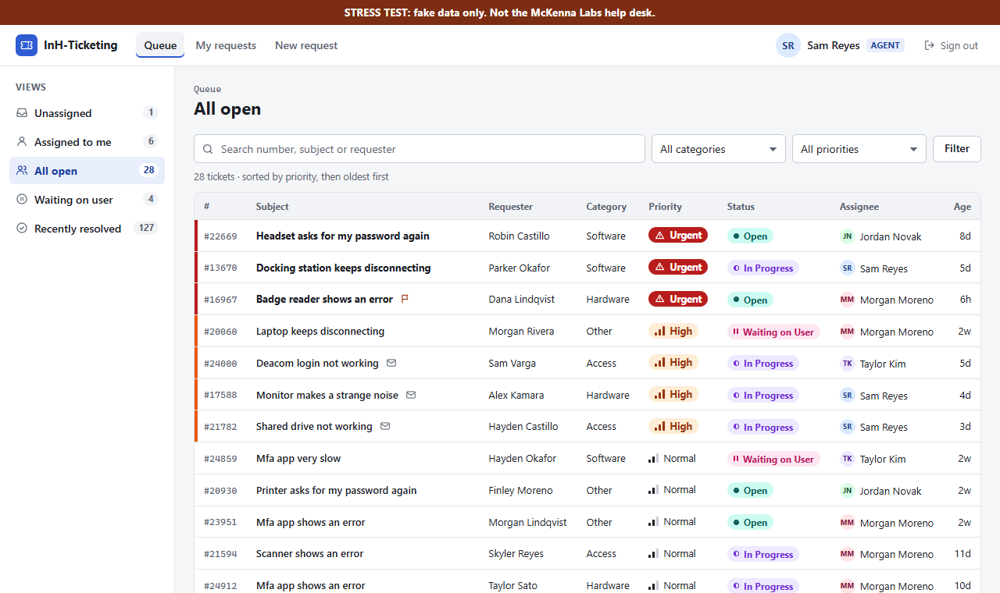

# Stress testing InH-Ticketing (stress-test branch only)

This branch exists to measure how fast the help desk is under load, on a
**private test server with invented data**. It is a copy of the deployment
branch (`milestone-6-deploy`) with a stress-test mode added.

> **Never merge this branch into `main` or `milestone-6-deploy`.** It contains
> automatic sign-in, which must never reach the real help desk.

## What's different from the real app

| | Real help desk | Stress-test copy |
|---|---|---|
| Sign-in | Microsoft 365 | None: you're signed in as a fake user automatically |
| People and tickets | Real staff | Invented: 300 `stress-req-…` staff, 5 `stress-agent-…` agents, 12,000 tickets over 5 years (about 30 open at a time), their emails, and about 2 GB of attachment files |
| Data between runs | — | Reset to the same saved starting point before every run, so runs can be compared |
| Email | Sent and read through the shared mailbox | None sent, none read (the worker still queues and "sends" them, into nowhere) |
| Certificate | Company certificate authority | Self-signed, made on the test server |
| Reachable from | Company network | The test server's Tailscale address only |
| Banner | — | A dark red **STRESS TEST** strip on every page |



The app protects itself: in stress-test mode it **refuses to start** if any
Microsoft 365 setting (`ENTRA_*`) is filled in or mailbox reading is on, and
the setup script refuses to touch a `.env` that isn't a stress-test one.
Automatic sign-in only works for accounts named `stress-…`, so a real account
can't be reached this way even if one somehow existed.

## The targets

| Measure | Target |
|---|---|
| 95% of responses within | half a second |
| 99% of responses within | 1 second |
| Failed requests | under 1% |
| Memory, all parts together (peak) | under 3.5 GB (what a 4 GB server leaves after Linux and Docker) |

These are about what staff notice: hardly anyone waiting. The average is
shown too, but isn't a target; a typical page takes tens of milliseconds,
which nobody can tell apart.

Every run is judged against these and gets a **PASS** or **FAIL**. The
`stress` scenario reports **INFO** instead: it deliberately pushes past the
limit, and its result is the capacity it found.

The app is held to the **planned production server's size**. The web app,
database, worker and proxy all **share the same 2 CPUs**, as they will on the
real 2-vCPU server, where whichever part is busy can use both. Their memory
is capped at 3.75 GB together. The load generator runs on 2 other CPUs, so it
takes nothing from the app (see `compose.stress.yaml`). So the results predict
the real server, not the test machine. One caveat: the test machine's
processor cores may be faster or slower than the production server's, which
shifts the results somewhat.

## 1. Prepare the test server (K12, Proxmox)

Use a **virtual machine**, not a container (LXC). Docker inside LXC needs
extra settings and doesn't always apply the CPU limits, which would spoil the
measurements.

1. In Proxmox, create a VM:
   * Debian 13 (netinst ISO), **6 CPU cores** (CPU type `host`), **10 GB
     memory**, **40 GB disk**.
   * Why 6 and 10: the app shares CPUs 0 and 1 and gets up to 3.75 GB, the
     load generator gets CPUs 2 and 3, and the rest is for Debian and Docker,
     so they don't steal time from the app. The setup stops with a clear
     message if the VM has fewer than 4 CPUs.
   * 40 GB is enough: the fake data takes about 3 GB (most of it attachment
     files), plus a saved copy of the database to reset to before each run.
   * In the installer, choose only "SSH server" and "standard system
     utilities".
2. Join it to your tailnet (see tailscale.com/download/linux) and give it a
   name, e.g. `inh-stress`. Keep the K12's firewall as it is (default deny
   inbound). The test site is only published on the VM's Tailscale address,
   but nothing on this VM should be opened to your home network or the
   internet.
3. Install Docker Engine and Compose from Docker's own repository: follow
   section 1.5 of [docs/deployment.md](../docs/deployment.md), using `debian`
   in place of `ubuntu` in both URLs. Compose must be 2.24.4 or later.
4. Install openssl and tmux, and make the folder:

   ```bash
   sudo apt install -y openssl tmux
   sudo mkdir -p /srv/inh-stress
   sudo chown "$USER" /srv/inh-stress
   ```

## 2. Send the code and set it up (from your PC)

In Git Bash, in a checkout of this branch (`git switch stress-test`):

```bash
sh stress/push-to-server.sh you@inh-stress
```

* `you@inh-stress` is however you SSH to the VM.
* Optional extra arguments: the folder (default `/srv/inh-stress`) and the
  site name (default `inh-stress.test`).

It sends the **last commit** of this branch (never uncommitted changes, and
never your `.env`), then runs `stress/server-setup.sh` on the server, which:

1. checks Docker, Compose and openssl;
2. writes a stress-test `.env` with random passwords and no Microsoft 365 or
   email settings;
3. publishes the site on the VM's Tailscale address only (or, without
   Tailscale, on the VM alone);
4. makes a self-signed certificate;
5. builds and starts the app (a few minutes the first time);
6. generates the fake data (about a minute; the attachment files take
   longest), and saves it as the starting point every run resets to.

Run the same command again after you change and commit anything. It keeps
the existing `.env`, certificate, data and reports.

### Looking at it in a browser (optional)

Add a line to your PC's hosts file (`C:\Windows\System32\drivers\etc\hosts`,
edited as administrator) with the address the setup printed:

```
100.x.y.z   inh-stress.test
```

Open https://inh-stress.test and accept the certificate warning. You're the
fake IT agent "stress-agent-01". To see the requester side, add
`?as=stress-req-0001` to the address, and `?as=stress-agent-01` to go back.

## 3. Run the tests (on the server)

```bash
ssh you@inh-stress
cd /srv/inh-stress
sh stress/run.sh --quick     # a ~1-minute trial run first, to check everything works
```

The full runs take a while. Run them inside tmux, so they carry on if your
SSH connection drops (`tmux attach` to get back to it):

```bash
tmux new -s stress
sh stress/run.sh all
```

| Scenario | What it simulates | Takes |
|---|---|---|
| `expected` | A normal busy period: 30 staff and all 5 IT agents active at once | ~11 min |
| `peak` | A very busy period, such as a company-wide outage: 100 people acting about 3x faster than normal | ~12 min |
| `stress` | A search for the limit: 25 more people every minute, up to 400, all acting very quickly | ~16 min |
| `soak` | Endurance: normal load held for 2 hours, to catch slow leaks | ~2 h |
| `all` | `expected`, `peak`, then `stress` | ~40 min |

Each run writes a folder in `stress/reports/`, named by date, time and
scenario.

**Every run starts from the same data.** A run adds tickets, replies and
files, so without a reset each run would face a bigger queue than the last.
Before each run, `run.sh` restores the database to the starting point saved
at setup and deletes the files earlier runs uploaded (a few seconds; the app
restarts). Add `--keep-data` to skip that; the report then says the run isn't
directly comparable.

**What the simulated people do.** Staff check their open and past tickets,
open one, download a file, raise a request (3 in 10 with a photo or document,
sized like real ones), reply, and mark a ticket resolved. IT agents work the
queue: views, search, open tickets, download files, public replies (some
"Send and set Waiting on User" or "Send and resolve"), internal notes, status
and priority changes in the side panel, and "Assign to me". Every page and
form is checked: a page that doesn't load as the fake user, or a form the app
doesn't accept, counts as a failure.

## 4. The report

Copy a report folder to your PC (from Git Bash on the PC):

```bash
scp -r you@inh-stress:/srv/inh-stress/stress/reports/2026-11-09_101500_expected .
```

Each folder contains:

* **report.html**: the one to share. Open it in a browser and use **Print →
  Save as PDF** to send it on, for example to the CFO. It has a plain-English
  summary, the verdict against each target, charts over time, the slowest
  pages, how busy the app's 2 CPUs were and how much memory it used (as a
  whole and per part), and how the test was set up.
* **summary.md**: the same key numbers, short, to paste into an email or
  Teams.
* **summary.json**: the key numbers, for comparing runs over time.
* The raw data: Locust's CSV files and its own HTML report, the proxy's timing
  of every request (`caddy-access.log`), container CPU and memory samples
  every 2 seconds (`resources.log`), and the run's settings (`meta.json`).

Reading it:

* **95% within** is the wait that 1 in 20 clicks exceeds; **99% within**, 1 in
  100. Both are measured from the load generator's side, on the same machine,
  so there's no network delay in them.
* "**Time inside the server alone**" is the proxy's own measurement. If it is
  much lower than the average, the time is going into the connection (TLS),
  not the app.
* In the `stress` run, **capacity** is the most people at once for which every
  stretch of the run kept 95% of responses within half a second, 99% within
  1 second, and failures under 1%.
* **Server resources** answers "are 2 CPUs and 4 GB enough?". CPU is shown as
  a share of the 2 CPUs the app shares, so the parts add up to the
  **whole app** row. A whole app averaging under 50% in the `expected` run
  leaves plenty of room; near 100%, the CPUs are the bottleneck. Memory for the
  whole app must stay under 3.5 GB.

A 2-minute trial on a development PC (not this setup, so not representative)
had 95% of responses within 48 ms and no failures. Its report, as an example
of the layout (a run on the server adds the CPU and memory charts and the
Server resources table):


## Changing things

* **More or less data**: generate it again, e.g. 50,000 tickets, then save it
  as the new starting point:

  ```bash
  docker compose -f compose.yaml -f compose.prod.yaml -f compose.stress.yaml \
    exec web python manage.py generate_load_data --clear --tickets 50000
  sh stress/run.sh --save-baseline
  ```

  `python manage.py generate_load_data --help` lists the other options, e.g.
  `--attachments 7000` for 5 years of attachment files (about 10 GB; give the
  VM 60 GB of disk).
* **A bigger or smaller app**: set the CPUs in `.env` on the server, e.g.
  `STRESS_APP_CPUS=0,1,2,3` and `STRESS_LOADGEN_CPUS=4,5` to see what 4 CPUs
  would give, or the memory ceilings (names and defaults in
  `compose.stress.yaml`). Then run `sh stress/server-setup.sh` to apply them.
  The report states what it ran with, and says so when it's more than the
  planned production server.
* **After the VM restarts**: run `sh stress/server-setup.sh` again. The site
  is published on the Tailscale address, which may not exist yet when Docker
  starts.

## Removing it

```bash
sh stress/server-setup.sh --down
```

This stops the app and deletes its database and attachments. The reports in
`stress/reports/` stay until you delete the folder (or the VM).

## Files

| File | What it is |
|---|---|
| `stress/push-to-server.sh` | Sends this branch to the server and runs the setup (run on your PC) |
| `stress/server-setup.sh` | Sets up, refreshes or removes the stress-test copy (run on the server) |
| `stress/run.sh` | Runs scenarios and writes reports (run on the server) |
| `stress/lib.sh` | Shared by the two scripts above: CPU checks, saving and restoring the starting point |
| `stress/locustfile.py` | What the simulated staff and IT agents do, and the scenarios |
| `stress/pages.py` | How the simulated people read the pages (checked against the real pages by the tests) |
| `stress/make_report.py` | Turns a run's data into the report |
| `compose.stress.yaml` | The stress-test layer on top of the production Docker setup |
| `stresstest/` | Stress-test mode: the safety checks, automatic sign-in, fake-data and clean-up commands, and their tests |

The tests (`python manage.py test stresstest`) check the safety checks, the
fake data, the page readers against the real pages, and the report's numbers
and verdicts. The Docker setup and the scripts can only be tried on the
server: start with `sh stress/run.sh --quick`.
