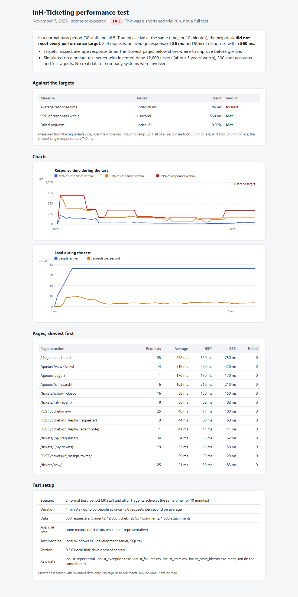

# Stress testing InH-Ticketing (stress-test branch only)

This branch exists to measure how fast the help desk is under load, on a
**private test server with invented data**. It is a copy of the deployment
branch (`milestone-6-deploy`) with a stress-test mode added.

> **Never merge this branch into `main` or `milestone-6-deploy`.** It contains
> automatic sign-in, which must never reach the real help desk.

## What's different from the real app

| | Real help desk | Stress-test copy |
|---|---|---|
| Sign-in | Microsoft 365 | None: you're signed in as a fake user automatically |
| People and tickets | Real staff | Invented: 300 `stress-req-…` staff, 5 `stress-agent-…` agents, 12,000 tickets over 5 years |
| Email | Sent and read through the shared mailbox | None sent, none read |
| Certificate | Company certificate authority | Self-signed, made on the test server |
| Reachable from | Company network | The test server's Tailscale address only |
| Banner | — | A dark red **STRESS TEST** strip on every page |


The app protects itself: in stress-test mode it **refuses to start** if any
Microsoft 365 setting (`ENTRA_*`) is filled in or mailbox reading is on, and
the setup script refuses to touch a `.env` that isn't a stress-test one.
Automatic sign-in only works for accounts named `stress-…`, so a real account
can't be reached this way even if one somehow existed.

## The targets

| Measure | Target |
|---|---|
| Average response time | under 20 ms |
| 99% of responses within | 1 second |
| Failed requests | under 1% |

Every run is judged against these and gets a **PASS** or **FAIL**. The
`stress` scenario reports **INFO** instead: it deliberately pushes past the
limit, and its result is the capacity it found.

The app is held to the **planned production server's size** (2 CPUs and 4 GB
of memory, split between the web app, database, worker and proxy; see
`compose.stress.yaml`). So the results predict the real server, not the test
machine. One caveat: the test machine's processor cores may be faster or
slower than the production server's, which shifts the results somewhat.

## 1. Prepare the test server (K12, Proxmox)

Use a **virtual machine**, not a container (LXC). Docker inside LXC needs
extra settings and doesn't always apply the CPU limits, which would spoil the
measurements.

1. In Proxmox, create a VM:
   * Debian 13 (netinst ISO), **6 CPU cores** (CPU type `host`), **10 GB
     memory**, **40 GB disk**.
   * Why 6 and 10: the app gets 2 CPUs / 4 GB, the load generator gets its own
     2 CPUs, and the rest is for Debian and Docker, so they don't steal time
     from the app.
   * In the installer, choose only "SSH server" and "standard system
     utilities".
2. Join it to your tailnet (see tailscale.com/download/linux) and give it a
   name, e.g. `inh-stress`. Keep the K12's firewall as it is (default deny
   inbound). The test site is only published on the VM's Tailscale address,
   but nothing on this VM should be opened to your home network or the
   internet.
3. Install Docker Engine and Compose from Docker's own repository: follow
   section 1.5 of [docs/deployment.md](../docs/deployment.md), using `debian`
   in place of `ubuntu` in both URLs. Compose must be 2.24.4 or later.
4. Install openssl and tmux, and make the folder:

   ```bash
   sudo apt install -y openssl tmux
   sudo mkdir -p /srv/inh-stress
   sudo chown "$USER" /srv/inh-stress
   ```

## 2. Send the code and set it up (from your PC)

In Git Bash, in a checkout of this branch (`git switch stress-test`):

```bash
sh stress/push-to-server.sh you@inh-stress
```

* `you@inh-stress` is however you SSH to the VM.
* Optional extra arguments: the folder (default `/srv/inh-stress`) and the
  site name (default `inh-stress.test`).

It sends the **last commit** of this branch (never uncommitted changes, and
never your `.env`), then runs `stress/server-setup.sh` on the server, which:

1. checks Docker, Compose and openssl;
2. writes a stress-test `.env` with random passwords and no Microsoft 365 or
   email settings;
3. publishes the site on the VM's Tailscale address only (or, without
   Tailscale, on the VM alone);
4. makes a self-signed certificate;
5. builds and starts the app (a few minutes the first time);
6. generates the fake data (about 20 seconds).

Run the same command again after you change and commit anything. It keeps
the existing `.env`, certificate, data and reports.

### Looking at it in a browser (optional)

Add a line to your PC's hosts file (`C:\Windows\System32\drivers\etc\hosts`,
edited as administrator) with the address the setup printed:

```
100.x.y.z   inh-stress.test
```

Open https://inh-stress.test and accept the certificate warning. You're the
fake IT agent "stress-agent-01". To see the requester side, add
`?as=stress-req-0001` to the address, and `?as=stress-agent-01` to go back.

## 3. Run the tests (on the server)

```bash
ssh you@inh-stress
cd /srv/inh-stress
sh stress/run.sh --quick     # a ~1-minute trial run first, to check everything works
```

The full runs take a while. Run them inside tmux, so they carry on if your
SSH connection drops (`tmux attach` to get back to it):

```bash
tmux new -s stress
sh stress/run.sh all
```

| Scenario | What it simulates | Takes |
|---|---|---|
| `expected` | A normal busy period: 30 staff and all 5 IT agents active at once | ~11 min |
| `peak` | A very busy period, such as a company-wide outage: 100 people acting about 3x faster than normal | ~12 min |
| `stress` | A search for the limit: 25 more people every minute, up to 400, all acting very quickly | ~16 min |
| `soak` | Endurance: normal load held for 2 hours, to catch slow leaks | ~2 h |
| `all` | `expected`, `peak`, then `stress` | ~40 min |

Each run writes a folder in `stress/reports/`, named by date, time and
scenario. Data stays the same between runs, so runs can be compared.

## 4. The report

Copy a report folder to your PC (from Git Bash on the PC):

```bash
scp -r you@inh-stress:/srv/inh-stress/stress/reports/2026-11-09_101500_expected .
```

Each folder contains:

* **report.html**: the one to share. Open it in a browser and use **Print →
  Save as PDF** to send it on, for example to the CFO. It has a plain-English
  summary, the verdict against each target, charts over time, the slowest
  pages, how much of its CPU and memory allowance each part used, and how the
  test was set up.
* **summary.md**: the same key numbers, short, to paste into an email or
  Teams.
* **summary.json**: the key numbers, for comparing runs over time.
* The raw data: Locust's CSV files and its own HTML report, the proxy's timing
  of every request (`caddy-access.log`), container CPU and memory samples
  every 2 seconds (`resources.log`), and the run's settings (`meta.json`).

Reading it:

* **Average** is what a typical click feels like; **99% within** is the worst
  that 1 in 100 clicks sees. Both are measured from the load generator's side,
  on the same machine, so there's no network delay in them.
* "**Time inside the server alone**" is the proxy's own measurement. If it is
  much lower than the average, the time is going into the connection (TLS),
  not the app.
* In the `stress` run, **capacity** is the most people at once for which every
  minute stayed within 1 second for 99% of responses with under 1% failures.
* In **Server resources**, a part near 100% of its CPU allowance is the
  bottleneck.

A first trial on a development PC (not this setup, so not representative)
averaged 86 ms, with the IT queue pages slowest (about 170–220 ms). If the
20 ms average is missed on the test server, the queue pages are the first
place to look. That trial's report, as an example of the layout:



## Changing things

* **More or less data**: generate it again, e.g. 50,000 tickets:

  ```bash
  docker compose -f compose.yaml -f compose.prod.yaml -f compose.stress.yaml \
    exec web python manage.py generate_load_data --clear --tickets 50000
  ```

  `python manage.py generate_load_data --help` lists the other options.
* **A bigger or smaller app**: set the limits in `.env` on the server (the
  names and defaults are in `compose.stress.yaml`, e.g.
  `STRESS_WEB_CPUS=1.5`), then run `sh stress/server-setup.sh` to apply them.
  The report states the limits it ran with, and says so when they're larger
  than the planned production server.
* **After the VM restarts**: run `sh stress/server-setup.sh` again. The site
  is published on the Tailscale address, which may not exist yet when Docker
  starts.

## Removing it

```bash
sh stress/server-setup.sh --down
```

This stops the app and deletes its database and attachments. The reports in
`stress/reports/` stay until you delete the folder (or the VM).

## Files

| File | What it is |
|---|---|
| `stress/push-to-server.sh` | Sends this branch to the server and runs the setup (run on your PC) |
| `stress/server-setup.sh` | Sets up, refreshes or removes the stress-test copy (run on the server) |
| `stress/run.sh` | Runs scenarios and writes reports (run on the server) |
| `stress/locustfile.py` | What the simulated staff and IT agents do, and the scenarios |
| `stress/make_report.py` | Turns a run's data into the report |
| `compose.stress.yaml` | The stress-test layer on top of the production Docker setup |
| `stresstest/` | Stress-test mode: the safety checks, automatic sign-in and fake-data commands |
